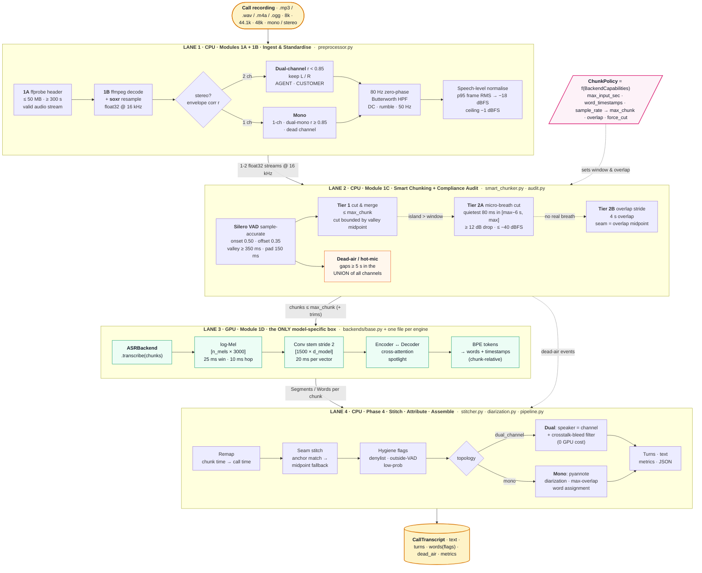
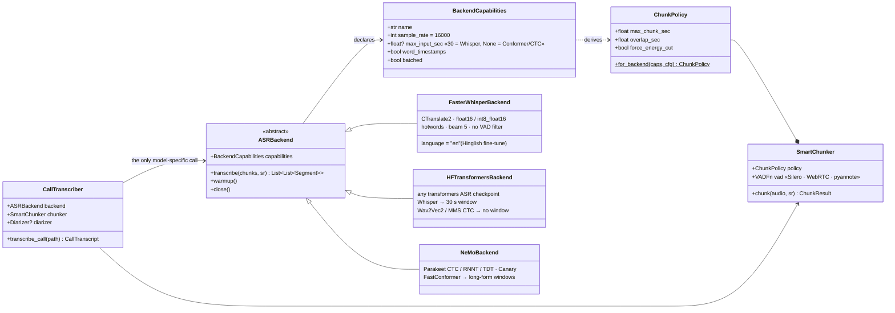
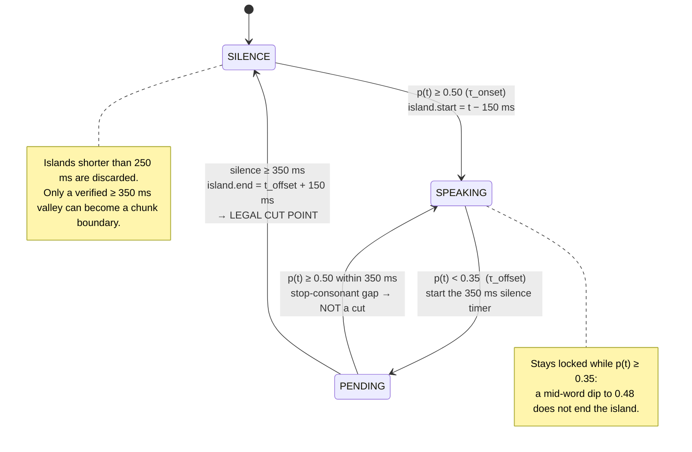
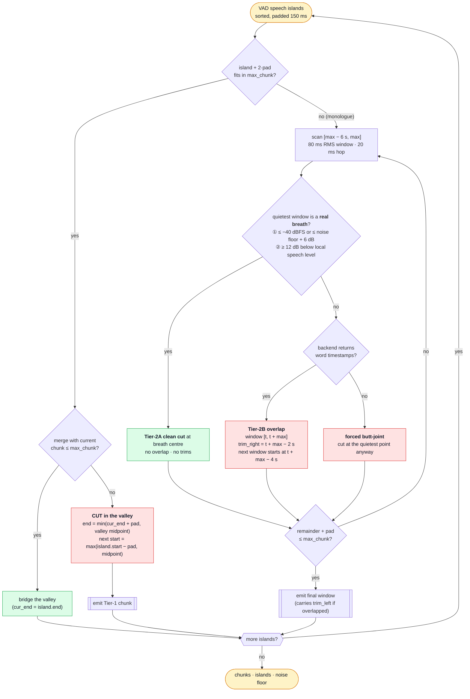

# Univo Production Speech-to-Text Pipeline — Engineering Specification v2 (Reviewed & Corrected)

**Scope:** Modules 1A–1D + Phase 4 for 5-minute-plus Hinglish counselling calls.
**Status:** v2 — production review of the v1 draft applied; CPU-side logic covered by 37 automated tests; model boundary made engine-agnostic.
**Repo:** `univo_asr_pipeline/` (this document is generated from the real source files — code blocks are byte-identical to the tested code).

---

## Table of contents

1. [The system on one whiteboard](#1-the-system-on-one-whiteboard)
2. [Design principles](#2-design-principles)
3. [Repository layout](#3-repository-layout)
4. [Modules 1A + 1B — ingestion & physical standardisation](#4-modules-1a--1b--ingestion--physical-standardisation)
5. [Module 1C — two-tier smart chunking & compliance audit](#5-module-1c--two-tier-smart-chunking--compliance-audit)
6. [Module 1D — inside the model (what the GPU does)](#6-module-1d--inside-the-model)
7. [Phase 4 — the model boundary, stitching, attribution, assembly](#7-phase-4--model-boundary-stitching-attribution-assembly)
8. [Model-agnosticism matrix](#8-model-agnosticism-matrix)
9. [Tests](#9-tests)
10. [Deployment, operations & calibration](#10-deployment-operations--calibration)
11. [Known limitations / next steps](#11-known-limitations--next-steps)
12. [Appendix — whiteboard talk-track & glossary](#12-appendix)

---

## 1. The system on one whiteboard

> Draw the four horizontal lanes top-to-bottom. Only **Lane 3** knows which model is running.




### 1.1 Plain-text version (copy onto a whiteboard in 60 seconds)

```text
 ┌────────────────────────────────────────────────────────────────────────────────────────────┐
 │ LANE 1 · CPU · INGEST & STANDARDISE                                        preprocessor.py │
 │  ffprobe (≤50MB, ≥300s) ─► ffmpeg+soxr decode → f32 @16k ─► stereo? ──r<0.85──► L/R split    │
 │                                                                 └──r≥0.85 / 1ch / dead──► mono │
 │  ─► 80 Hz zero-phase HPF ─► speech-level normalise (p95 RMS → −18 dBFS, ceiling −1 dBFS)      │
 └───────────────────────────────────────┬────────────────────────────────────────────────────┘
                                         ▼  1–2 float32 streams
 ┌────────────────────────────────────────────────────────────────────────────────────────────┐
 │ LANE 2 · CPU · SMART CHUNK + AUDIT                                 smart_chunker.py audit.py │
 │  Silero VAD (0.50/0.35, ≥350 ms valley, 150 ms pad, sample-accurate)                        │
 │   ├─ Tier 1  merge islands ≤ max_chunk, cut in valley (bounded by midpoint)                 │
 │   ├─ Tier 2A island > window → quietest 80 ms in [max−6, max] if it is a REAL breath         │
 │   ├─ Tier 2B else 4 s overlap stride, seam = overlap midpoint (needs word timestamps)        │
 │   └─ Dead-air ≥ 5 s on the UNION of channels · hot-mic if gap > −50 dBFS                     │
 │  ChunkPolicy = f(BackendCapabilities): max_chunk · overlap · force_cut                       │
 └───────────────────────────────────────┬────────────────────────────────────────────────────┘
                                         ▼  chunks ≤ max_chunk (+ trim seams)
 ┌────────────────────────────────────────────────────────────────────────────────────────────┐
 │ LANE 3 · GPU · ASRBackend.transcribe(chunks)            ← the ONLY model-specific box        │
 │  log-Mel [n_mels×3000] ─► conv stem ÷2 [1500×d_model] ─► encoder ⇄ decoder ─► BPE → words   │
 │  faster-whisper (CT2) │ transformers (Whisper / CTC) │ NeMo (Parakeet / Canary) │ …          │
 └───────────────────────────────────────┬────────────────────────────────────────────────────┘
                                         ▼  Segments / Words per chunk (chunk-relative)
 ┌────────────────────────────────────────────────────────────────────────────────────────────┐
 │ LANE 4 · CPU · STITCH · ATTRIBUTE · ASSEMBLE               stitcher.py diarization.py        │
 │  remap → seam stitch (anchor → midpoint) → flags (denylist / outside-VAD / low-prob)         │
 │  dual: speaker = channel + crosstalk filter │ mono: pyannote → max-overlap assignment        │
 │  turns · text · metrics (RTF, seams, flags) · CallTranscript JSON                            │
 └────────────────────────────────────────────────────────────────────────────────────────────┘
```

---

## 2. Design principles

1. **One model boundary.** Everything that is true of *audio* (decoding, levels, VAD, chunking, stitching, audit) lives in CPU code we own. Everything that is true of *a model* lives behind `ASRBackend`. The chunker never contains the number 30 — it asks the backend.
2. **Capabilities, not assumptions.** A backend declares `sample_rate`, `max_input_sec` (`None` for Conformer/CTC), `word_timestamps`, `batched`. The chunker derives its policy from that: Whisper → 28 s windows + 4 s overlap; Parakeet → 60 s windows; a segment-only engine → no overlap, forced energy cuts.
3. **Absolute thresholds are only meaningful after level normalisation.** Hence speech-level normalisation first, then −40 / −50 dBFS rules — and every threshold is in `config.py`, nothing is a literal in module code.
4. **Never feed the decoder silence, never cut inside a word.** Cuts happen only in verified ≥ 350 ms valleys, at real micro-breaths, or with a 4 s overlap. Trailing padding is always bounded by the valley midpoint.
5. **Flag, don't delete.** Crosstalk, hallucination suspects and low-probability words stay in `words[]` with flags and are excluded from `text`. Auditors can see what the model said and why it was dropped.
6. **Everything is typed.** No raw dicts cross a module boundary (`schemas.py`).
7. **CPU logic is tested without a GPU.** VAD and backend are injectable; 37 tests run in < 3 s on synthetic audio and real `ffmpeg` decodes.




---

## 3. Repository layout

```text
univo_asr_pipeline/
├── pyproject.toml                      # pinned ranges; optional extras per engine
├── ARCHITECTURE.md                     # this file (generated by docs/build_doc.py)
├── docs/
│   ├── ARCHITECTURE.template.md
│   ├── build_doc.py
│   └── diagrams/*.mmd  *.svg  *.png    # whiteboard diagrams (Mermaid + rendered)
├── src/univo_asr/
│   ├── config.py                       # every tunable, frozen dataclasses
│   ├── schemas.py                      # SpeechIsland · Chunk · Word · Segment · DeadAirEvent · CallTranscript
│   ├── preprocessor.py                 # [1A+1B] ffprobe/ffmpeg · channel routing · HPF · level
│   ├── smart_chunker.py                # [1C]    SileroVAD adapter · ChunkPolicy · SmartChunker
│   ├── audit.py                        # [1C]    call-level dead-air / hot-mic
│   ├── stitcher.py                     # [P4]    remap · seam stitch · flags · crosstalk · turns
│   ├── diarization.py                  # [P4]    Diarizer protocol · pyannote 4.x adapter
│   ├── pipeline.py                     # [P4]    CallTranscriber orchestrator
│   ├── cli.py                          #         python -m univo_asr.cli call.mp3 --model …
│   └── backends/
│       ├── base.py                     # ASRBackend · BackendCapabilities   ← THE boundary
│       ├── __init__.py                 # registry: create_backend("faster-whisper", …)
│       ├── faster_whisper_backend.py   # CTranslate2 Whisper (primary)
│       ├── hf_transformers_backend.py  # any transformers ASR checkpoint (Whisper, Wav2Vec2, MMS …)
│       └── nemo_backend.py             # NVIDIA NeMo FastConformer (Parakeet / Canary)
├── scripts/
│   └── inspect_module_1d.py            # [1D] demo: tensor shapes + BPE token counts, config-driven
└── tests/
    ├── conftest.py                     # synthetic audio · EnergyVAD stub · BurstBackend fake
    ├── test_chunker.py                 # 11 tests: invariants, Tier 1/2A/2B, policies
    ├── test_preprocessor.py            # 12 tests: real ffmpeg on WAV/MP3, routing, HPF, levels
    ├── test_stitcher_audit.py          #  9 tests: anchors, fallback, flags, turns, union audit
    └── test_pipeline.py                #  5 tests: end-to-end mono / monologue / dual + crosstalk
```

Install:

```bash
pip install -e ".[faster-whisper,dev]"            # CPU workers: pip install torch --index-url https://download.pytorch.org/whl/cpu
pip install -e ".[transformers]"  # or .[nemo], .[diarization]
pytest -q                                         # no GPU, no torch needed for the suite
```

---

## 4. Modules 1A + 1B — ingestion & physical standardisation

### 4.1 Target format ("what the model wants")

Every modern STT encoder (Whisper, Conformer, Wav2Vec2) consumes the same thing:

| Property | Value | Why |
|---|---|---|
| dtype | `float32`, 1-D | model input tensor |
| sample rate | **16 000 Hz** (backend-declared; 16 k is the de-facto standard) | Nyquist → 8 kHz covers all vowel formants and consonant hiss; 8 kHz telephony loses /s/ /f/ /θ/; 44.1/48 kHz is wasted compute |
| channels | one stream per speaker (dual-channel) or one mixed stream (mono) | deterministic diarization for free when the dialer records agent/customer separately |
| level | speech ≈ −18 dBFS, peak ≤ −1 dBFS | VAD and every absolute dBFS rule downstream assume a known level |

```text
[.mp3 / .wav / .m4a / .ogg  ≤ 50 MB]
   │ 1A  ffprobe: valid audio stream? header duration ≥ 300 s?            (≈ 50 ms, zero PCM RAM)
   ▼
[compressed stream]
   │ 1B  ffmpeg -af aresample=soxr:precision=28:cutoff=0.95:osr=16000     (decode + resample, one pass)
   ▼        anti-imaging knee ≈ 3.8 kHz for 8 k input · anti-aliasing knee ≈ 7.6 kHz for 48 k input
[float32 [n, C] @ 16 kHz]
   │ 1B  stereo topology: envelope correlation r of L vs R
   │       r <  0.85  → dual-channel, keep L (AGENT) and R (CUSTOMER)
   │       r ≥  0.85  → dual-mono, average to one stream
   │       dead track → mono from the live track
   ▼
[1–2 streams]
   │ 1B  80 Hz 4th-order Butterworth, zero-phase  (DC · rumble · 50 Hz mains)
   │ 1B  speech-level normalise: p95 frame RMS → −18 dBFS, ceiling 0.891 (−1 dBFS)
   ▼
[clean neural-ready streams] ──► Module 1C
```

### 4.2 Step-by-step rationale

**1A — header check before decoding.** Decoding 50 MB of MP3 expands 10–15× into float32 PCM; rejecting short or corrupt files from the container header costs nothing. `ffprobe` reads the container; for VBR MP3 without a Xing/Info header the duration is an estimate (or absent), so the business rule is re-checked on the decoded sample count — *the samples are the truth, the header is a hint*.

**1B — decode + resample in ffmpeg.** `aresample` with the **libsoxr** engine at `precision=28` is a band-limited windowed-sinc resampler (the same family as the Kaiser design in v1) and runs inside the decoder pass. `cutoff=0.95` places the low-pass knee at 0.95 × the smaller Nyquist frequency:

- *Up-sampling 8 kHz → 16 kHz:* the content stops at 4 kHz; naive repetition/linear interpolation creates **spectral images** in 4–8 kHz (metallic "ghost" partials). The sinc low-pass at ≈ 3.8 kHz suppresses them.
- *Down-sampling 48 kHz → 16 kHz:* anything above 8 kHz would **alias** back into the voice band; the low-pass at ≈ 7.6 kHz removes it first.

**1B — stereo topology.** Telephony dialers often record agent and customer on separate tracks. v1 used sample-level Pearson at lag 0, which fails on dual-mono with a one-sample inter-channel delay. v2 correlates 50 ms RMS **envelopes**: immune to lag and polarity, and the *sign* is informative — alternating speakers produce strongly negative r (tested). A channel below −60 dBFS is treated as unplugged.

**1B — high-pass, no spectral denoising.** 4th-order Butterworth at 80 Hz, applied with `sosfiltfilt` (zero-phase) so onsets are not delayed. Attenuation ≈ 16 dB at 50 Hz, < 0.1 dB at 1 kHz, no effect on fundamentals (≥ 85 Hz male, ≥ 165 Hz female). The golden rule stands: **never run `noisereduce` / RNNoise before an ASR model** — Whisper-class models were trained on natural noise; spectral subtraction leaves "musical noise" and carves holes in unvoiced Hinglish consonants (/s/ /f/ /k/ /t/), which is a hallucination trigger.

**1B — speech-level normalisation (replaces peak normalisation).** The 95th percentile of 50 ms frame RMS tracks the *speech* level and ignores a single click (which occupies ≪ 5 % of frames). Gain is capped at +40 dB (a dead track must not be amplified into noise), samples above −1 dBFS are hard-clipped; if more than 0.01 % of samples would clip (crackly line) we fall back to peak-limiting. All downstream absolute thresholds (−40 dBFS breath, −50 dBFS hot-mic) rely on this.

### 4.3 Code — `src/univo_asr/config.py`

```python
# File: src/univo_asr/config.py
"""Every tunable of the pipeline lives here, grouped by module, frozen (immutable).

Production rule: code never carries magic numbers. If you need to tune a threshold
for a new dialer / telephony provider, you change a config value, not a module.
"""
from __future__ import annotations

from dataclasses import dataclass, field
from typing import Tuple


@dataclass(frozen=True)
class IngestConfig:
    """Module 1A - header validation & decoding (ffprobe / ffmpeg)."""
    min_duration_sec: float = 300.0        # business rule: counselling calls >= 5 min
    max_file_mb: float = 50.0              # reject anything bigger before touching ffmpeg
    target_sr: int = 16000                 # overridden by the backend's capabilities
    ffmpeg_bin: str = "ffmpeg"
    ffprobe_bin: str = "ffprobe"
    decode_timeout_sec: float = 180.0
    # soxr resampler: 'precision=28' = very-high quality, 'cutoff=0.95' puts the
    # low-pass knee at 0.95 x the smaller Nyquist (3.8 kHz for 8k, 7.6 kHz for 48k->16k)
    resampler_args: str = "resampler=soxr:precision=28:cutoff=0.95"


@dataclass(frozen=True)
class ChannelConfig:
    """Module 1B - stereo topology routing."""
    dual_mono_corr_threshold: float = 0.85  # envelope corr >= this => same audio on L/R
    envelope_frame_ms: float = 50.0         # RMS envelope frame used for lag-tolerant corr
    dead_channel_dbfs: float = -60.0        # a channel this quiet is unplugged -> treat as mono
    channel_roles: Tuple[str, str] = ("AGENT", "CUSTOMER")  # verify against YOUR dialer!


@dataclass(frozen=True)
class FilterConfig:
    """Module 1B - high-pass filter (hum / rumble removal). No spectral denoising."""
    highpass_hz: float = 80.0
    highpass_order: int = 4                 # 4th-order Butterworth, zero-phase (sosfiltfilt)


@dataclass(frozen=True)
class LevelConfig:
    """Module 1B - speech-level (not peak) normalisation.

    Peak normalisation is dominated by a single click/cough; a 95th-percentile frame
    RMS tracks the *speech* level and makes every absolute dBFS threshold downstream
    (dead-air, hot-mic, micro-breath) meaningful across dialers.
    """
    target_speech_dbfs: float = -18.0
    frame_ms: float = 50.0
    speech_percentile: float = 95.0
    peak_ceiling: float = 0.891             # -1.0 dBFS; samples above are hard-clipped
    max_clip_fraction: float = 1e-4         # if more samples than this would clip, scale down instead
    max_gain_db: float = 40.0               # never amplify a dead track into noise


@dataclass(frozen=True)
class VADConfig:
    """Module 1C - Silero VAD parameters (16 kHz, 512-sample / 32 ms windows)."""
    onset_threshold: float = 0.50           # tau_onset
    offset_threshold: float = 0.35          # tau_offset (hysteresis)
    min_speech_ms: int = 250
    min_silence_ms: int = 350               # cuts are legal only in >= 350 ms valleys
    speech_pad_ms: int = 150                # envelope padding for /h/, /s/ edges
    use_onnx: bool = False                  # True => onnxruntime (lighter CPU workers)


@dataclass(frozen=True)
class ChunkConfig:
    """Module 1C - how ChunkPolicy is derived from a backend's capabilities."""
    preferred_chunk_sec: float = 28.0       # for window-limited models (Whisper: 30 s)
    model_window_margin_sec: float = 2.0    # keep this far below the model's hard limit
    long_form_chunk_sec: float = 60.0       # for models without a hard window (Conformer/CTC)
    search_window_sec: float = 6.0          # Tier-2A scans [max - 6 s, max]
    overlap_sec: float = 4.0                # Tier-2B stride overlap (needs word timestamps)
    boundary_pad_sec: float = 0.25          # extra context around a Tier-1 cut, bounded by valley midpoint
    breath_window_sec: float = 0.08         # 80 ms RMS window
    breath_hop_sec: float = 0.02            # 20 ms hop
    breath_max_dbfs: float = -40.0          # a micro-breath must be <= this absolute level ...
    breath_floor_margin_db: float = 6.0     # ... OR within 6 dB of the stream's noise floor (noisy lines)
    breath_min_drop_db: float = 12.0        # AND >= 12 dB below the local speech level (rejects syllabic dips)
    noise_floor_percentile: float = 5.0     # noise floor = 5th percentile of 20 ms frame RMS


@dataclass(frozen=True)
class AuditConfig:
    """Module 1C byproduct - dead-air & hot-mic compliance audit (call-level)."""
    dead_air_min_sec: float = 5.0
    hot_mic_dbfs: float = -50.0             # gap energy above this => mic was not muted


@dataclass(frozen=True)
class StitchConfig:
    """Phase 4 - seam stitching, crosstalk, hallucination hygiene, turn building."""
    anchor_max_dt_sec: float = 0.60         # same word in both chunks within this => anchor
    crosstalk_margin_db: float = 6.0        # other channel louder by this => bleed, not speech
    outside_vad_tolerance_sec: float = 0.50 # words further than this from any VAD island are suspect
    min_word_prob: float = 0.0              # 0 disables (backends without probs return None)
    turn_gap_sec: float = 1.0               # same speaker, gap > this => new turn
    drop_flagged_from_text: bool = True     # flagged words stay in `words` for audit, leave `text`
    hallucination_phrases: Tuple[str, ...] = (
        "thank you for watching", "thanks for watching", "please subscribe",
        "subscribe to my channel", "like and subscribe", "see you in the next video",
    )


@dataclass(frozen=True)
class PipelineConfig:
    ingest: IngestConfig = field(default_factory=IngestConfig)
    channels: ChannelConfig = field(default_factory=ChannelConfig)
    filter: FilterConfig = field(default_factory=FilterConfig)
    level: LevelConfig = field(default_factory=LevelConfig)
    vad: VADConfig = field(default_factory=VADConfig)
    chunking: ChunkConfig = field(default_factory=ChunkConfig)
    audit: AuditConfig = field(default_factory=AuditConfig)
    stitch: StitchConfig = field(default_factory=StitchConfig)
```

### 4.4 Code — `src/univo_asr/schemas.py`

```python
# File: src/univo_asr/schemas.py
"""Typed data contracts shared by every module. No raw dicts cross a module boundary."""
from __future__ import annotations

from dataclasses import dataclass, field, asdict
from typing import Dict, List, Optional


@dataclass
class SpeechIsland:
    """A VAD speech region in stream-global seconds (already envelope-padded)."""
    start: float
    end: float

    @property
    def duration(self) -> float:
        return self.end - self.start


@dataclass
class Chunk:
    """One model input window. `start`/`end` are stream-global seconds.

    tier:        "T1_VAD_MERGE" | "T2A_ENERGY_CUT" | "T2B_OVERLAP"
    trim_left:   words whose centre is <= trim_left belong to the PREVIOUS chunk
    trim_right:  words whose centre is  > trim_right belong to the NEXT chunk
    """
    index: int
    start: float
    end: float
    tier: str
    trim_left: Optional[float] = None
    trim_right: Optional[float] = None

    @property
    def duration(self) -> float:
        return self.end - self.start

    @property
    def overlaps_previous(self) -> bool:
        return self.trim_left is not None


@dataclass
class Word:
    text: str
    start: float
    end: float
    prob: Optional[float] = None
    speaker: Optional[str] = None
    chunk_index: int = -1
    flags: List[str] = field(default_factory=list)  # e.g. "crosstalk_bleed", "outside_vad", "low_prob", "denylist"

    @property
    def center(self) -> float:
        return 0.5 * (self.start + self.end)

    @property
    def is_clean(self) -> bool:
        return not self.flags


@dataclass
class Segment:
    """What a backend returns per chunk (chunk-relative seconds)."""
    text: str
    start: float
    end: float
    words: List[Word]
    no_speech_prob: Optional[float] = None
    avg_logprob: Optional[float] = None


@dataclass
class DeadAirEvent:
    start: float
    end: float
    duration: float
    dbfs: float                     # energy of the gap on the mixed signal
    hot_mic: bool                   # True => somebody's mic was open (noise/breathing bled through)
    channel_dbfs: Dict[str, float] = field(default_factory=dict)


@dataclass
class ChunkResult:
    chunks: List[Chunk]
    islands: List[SpeechIsland]
    noise_floor_dbfs: float


@dataclass
class StreamResult:
    label: str
    words: List[Word]
    chunks: List[Chunk]
    islands: List[SpeechIsland]
    noise_floor_dbfs: float


@dataclass
class Turn:
    speaker: str
    start: float
    end: float
    text: str


@dataclass
class CallTranscript:
    source_path: str
    duration_sec: float
    topology: str                    # "dual_channel" | "mono"
    backend: str
    text: str                        # clean, turn-formatted transcript
    turns: List[Turn]
    words: List[Word]                # every word incl. flagged ones (for audit)
    dead_air: List[DeadAirEvent]
    streams: Dict[str, StreamResult]
    metrics: Dict[str, float]        # timings, RTF, chunk counts, flag counts

    def to_dict(self) -> dict:
        return asdict(self)
```

### 4.5 Code — `src/univo_asr/preprocessor.py`

```python
# File: src/univo_asr/preprocessor.py
"""Modules 1A & 1B - CPU-side ingestion and physical standardisation.

Pipeline (per call):
    ffprobe header check  ->  ffmpeg decode + soxr resample to target_sr (native channel count)
    ->  stereo topology routing (dual-channel vs dual-mono vs dead channel)
    ->  zero-phase 80 Hz Butterworth high-pass (DC, rumble, 50 Hz mains)
    ->  speech-level normalisation (p95 frame RMS -> -18 dBFS, hard ceiling -1 dBFS)

Design decisions (see ARCHITECTURE.md "Review findings"):
    * ffmpeg/ffprobe instead of torchaudio I/O: torchaudio.info() was removed in 2.9 and
      torchaudio.load() is now a thin alias over torchcodec. ffmpeg is the de-facto
      production decoder (openai-whisper's load_audio() does exactly this) and handles
      every container a dialer can emit (mp3/wav/m4a/ogg/opus/amr).
    * Resampling happens inside ffmpeg (libsoxr, VHQ) in the same pass as decoding.
    * Everything downstream is float32 numpy at `target_sr`; torch is only needed by VAD.
"""
from __future__ import annotations

import json
import logging
import os
import shutil
import subprocess
from dataclasses import dataclass, field
from typing import Dict, Optional, Tuple

import numpy as np
from scipy.signal import butter, sosfiltfilt

from .config import ChannelConfig, FilterConfig, IngestConfig, LevelConfig, PipelineConfig

log = logging.getLogger(__name__)

EPS = 1e-9


class IngestError(ValueError):
    """Raised for files that must be rejected (too short, corrupt, unreadable)."""


@dataclass
class ProbeInfo:
    duration_sec: float
    sample_rate: int
    channels: int
    codec: str
    container: str
    size_bytes: int


@dataclass
class LevelStats:
    speech_dbfs_before: float
    gain_db: float
    clipped_fraction: float
    mode: str                      # "speech_level" | "peak_limited" | "dead_track"


@dataclass
class PreprocessedCall:
    streams: Dict[str, np.ndarray]           # label -> 1-D float32 at `sample_rate`
    topology: str                            # "dual_channel" | "mono"
    sample_rate: int
    duration_sec: float                      # from decoded samples (the truth), not the header
    probe: ProbeInfo
    channel_correlation: Optional[float]     # envelope correlation for stereo inputs
    level_stats: Dict[str, LevelStats] = field(default_factory=dict)

    def mixed_mono(self) -> np.ndarray:
        """Energy-preserving mono mix used for call-level audits / diarization."""
        arrs = list(self.streams.values())
        if len(arrs) == 1:
            return arrs[0]
        return (np.sum(arrs, axis=0) / len(arrs)).astype(np.float32)


# --------------------------------------------------------------------------------------
# dB helpers
# --------------------------------------------------------------------------------------
def dbfs(x: float) -> float:
    return 20.0 * np.log10(max(float(x), EPS))


def frame_rms(x: np.ndarray, frame: int) -> np.ndarray:
    """RMS per non-overlapping frame (tail is dropped)."""
    n = (len(x) // frame) * frame
    if n == 0:
        return np.array([np.sqrt(np.mean(x ** 2))], dtype=np.float32) if len(x) else np.zeros(1, np.float32)
    return np.sqrt(np.mean(x[:n].reshape(-1, frame) ** 2, axis=1))


# --------------------------------------------------------------------------------------
# Module 1A - header check & decode
# --------------------------------------------------------------------------------------
def probe(path: str, cfg: IngestConfig) -> ProbeInfo:
    """< 10 ms container-header inspection; rejects before any PCM is allocated."""
    if not os.path.isfile(path):
        raise IngestError(f"file not found: {path}")
    size = os.path.getsize(path)
    if size > cfg.max_file_mb * 1024 * 1024:
        raise IngestError(f"file is {size / 1e6:.1f} MB > {cfg.max_file_mb} MB limit")
    if shutil.which(cfg.ffprobe_bin) is None:
        raise RuntimeError(f"{cfg.ffprobe_bin} not on PATH")

    cmd = [
        cfg.ffprobe_bin, "-v", "error", "-select_streams", "a:0",
        "-show_entries", "stream=sample_rate,channels,codec_name:format=duration,format_name",
        "-of", "json", path,
    ]
    try:
        out = subprocess.run(cmd, capture_output=True, text=True, timeout=30, check=True).stdout
        meta = json.loads(out)
        stream = meta["streams"][0]
        fmt = meta["format"]
    except (subprocess.CalledProcessError, subprocess.TimeoutExpired, KeyError, IndexError, json.JSONDecodeError) as e:
        raise IngestError(f"ffprobe could not read an audio stream from {path}: {e}") from e

    # MP3 (esp. VBR without a Xing/Info header) may report no duration at all -> NaN,
    # so we only *reject* here when the header is confidently short; decode re-checks.
    duration = float(fmt.get("duration", "nan"))
    info = ProbeInfo(
        duration_sec=duration,
        sample_rate=int(stream.get("sample_rate", 0) or 0),
        channels=int(stream.get("channels", 0) or 0),
        codec=str(stream.get("codec_name", "?")),
        container=str(fmt.get("format_name", "?")),
        size_bytes=size,
    )
    if info.channels <= 0 or info.sample_rate <= 0:
        raise IngestError(f"invalid audio header (channels={info.channels}, sr={info.sample_rate})")
    if np.isfinite(duration) and duration < cfg.min_duration_sec:
        raise IngestError(f"call duration {duration:.1f}s < {cfg.min_duration_sec:.0f}s business minimum")
    return info


def decode(path: str, target_sr: int, channels: int, cfg: IngestConfig) -> np.ndarray:
    """Decode + soxr-resample in ONE ffmpeg pass. Returns float32 [n_samples, n_channels]."""
    if shutil.which(cfg.ffmpeg_bin) is None:
        raise RuntimeError(f"{cfg.ffmpeg_bin} not on PATH")
    n_ch = 1 if channels <= 1 else 2  # >2 channels is not a telephony layout; fold to stereo
    cmd = [
        cfg.ffmpeg_bin, "-nostdin", "-hide_banner", "-loglevel", "error", "-threads", "1",
        "-i", path, "-vn", "-map", "0:a:0", "-ac", str(n_ch),
        "-af", f"aresample={cfg.resampler_args}:osr={target_sr}",
        "-ar", str(target_sr), "-f", "f32le", "-acodec", "pcm_f32le", "pipe:1",
    ]
    try:
        proc = subprocess.run(cmd, capture_output=True, timeout=cfg.decode_timeout_sec, check=True)
    except subprocess.CalledProcessError as e:
        raise IngestError(f"ffmpeg decode failed: {e.stderr.decode(errors='ignore')[-400:]}") from e
    except subprocess.TimeoutExpired as e:
        raise IngestError(f"ffmpeg decode timed out after {cfg.decode_timeout_sec}s") from e
    pcm = np.frombuffer(proc.stdout, dtype=np.float32)
    if pcm.size == 0:
        raise IngestError("ffmpeg produced no samples (corrupt or empty audio stream)")
    pcm = pcm[: (pcm.size // n_ch) * n_ch].reshape(-1, n_ch)
    return np.ascontiguousarray(pcm)


# --------------------------------------------------------------------------------------
# Module 1B - stereo topology routing
# --------------------------------------------------------------------------------------
def envelope_correlation(a: np.ndarray, b: np.ndarray, sr: int, frame_ms: float) -> float:
    """Pearson correlation of the two channels' RMS envelopes.

    Lag-tolerant: a 1-sample inter-channel delay (common in some encoders) drives the
    sample-level Pearson r towards 0 for high-frequency content, which would wrongly
    classify dual-mono as two speakers. RMS envelopes at 50 ms resolution are immune to
    that and to polarity inversion. The SIGN is kept on purpose: alternating speakers give
    strongly negative envelope correlation - the best possible evidence of two channels.
    """
    frame = max(1, int(sr * frame_ms / 1000))
    ea, eb = frame_rms(a, frame), frame_rms(b, frame)
    n = min(len(ea), len(eb))
    if n < 4:
        return 1.0
    ea, eb = ea[:n] - ea[:n].mean(), eb[:n] - eb[:n].mean()
    denom = np.sqrt(np.sum(ea ** 2) * np.sum(eb ** 2))
    return float(np.sum(ea * eb) / denom) if denom > EPS else 1.0


def route_channels(pcm: np.ndarray, sr: int, cfg: ChannelConfig) -> Tuple[str, Dict[str, np.ndarray], Optional[float]]:
    """Return (topology, streams, correlation)."""
    if pcm.shape[1] == 1:
        return "mono", {"mono": pcm[:, 0].copy()}, None

    ch0, ch1 = pcm[:, 0], pcm[:, 1]
    lvl0, lvl1 = dbfs(np.sqrt(np.mean(ch0 ** 2))), dbfs(np.sqrt(np.mean(ch1 ** 2)))
    if lvl0 < cfg.dead_channel_dbfs and lvl1 < cfg.dead_channel_dbfs:
        return "mono", {"mono": (0.5 * (ch0 + ch1)).astype(np.float32)}, None
    if lvl1 < cfg.dead_channel_dbfs:        # right track unplugged -> mono from left
        return "mono", {"mono": ch0.copy()}, None
    if lvl0 < cfg.dead_channel_dbfs:        # left track unplugged -> mono from right
        return "mono", {"mono": ch1.copy()}, None

    corr = envelope_correlation(ch0, ch1, sr, cfg.envelope_frame_ms)
    if corr >= cfg.dual_mono_corr_threshold:
        # Same programme on both tracks ("dual-mono") -> average (power-neutral for identical signals)
        return "mono", {"mono": (0.5 * (ch0 + ch1)).astype(np.float32)}, corr
    role0, role1 = cfg.channel_roles
    return "dual_channel", {role0: ch0.copy(), role1: ch1.copy()}, corr


# --------------------------------------------------------------------------------------
# Module 1B - filtering & level normalisation
# --------------------------------------------------------------------------------------
def highpass(x: np.ndarray, sr: int, cfg: FilterConfig) -> np.ndarray:
    """Zero-phase Butterworth high-pass. Zero-phase matters: a causal IIR shifts onsets
    (group delay) and would bias every downstream timestamp by a few ms at 80 Hz."""
    sos = butter(cfg.highpass_order, cfg.highpass_hz, btype="highpass", fs=sr, output="sos")
    return sosfiltfilt(sos, x.astype(np.float64)).astype(np.float32)


def normalize_level(x: np.ndarray, sr: int, cfg: LevelConfig) -> Tuple[np.ndarray, LevelStats]:
    """Speech-level normalisation with a hard peak ceiling.

    1. speech level  := p95 of 50 ms frame RMS (a single click occupies << 5 % of frames)
    2. gain          := target - speech level, capped at max_gain_db
    3. if applying the gain would clip more than max_clip_fraction of samples the
       recording is genuinely hot -> fall back to peak-limiting; otherwise hard-clip the
       handful of transient samples (a clipped click is still just a click).
    """
    frame = max(1, int(sr * cfg.frame_ms / 1000))
    rms = frame_rms(x, frame)
    speech_level = float(np.percentile(rms, cfg.speech_percentile))
    speech_dbfs = dbfs(speech_level)

    if speech_dbfs < -90.0:                             # digital silence / dead track
        return x.copy(), LevelStats(speech_dbfs, 0.0, 0.0, "dead_track")

    gain_db = min(cfg.target_speech_dbfs - speech_dbfs, cfg.max_gain_db)
    gain = 10.0 ** (gain_db / 20.0)
    y = x * gain
    clip_frac = float(np.mean(np.abs(y) > cfg.peak_ceiling))
    if clip_frac > cfg.max_clip_fraction:
        peak = float(np.max(np.abs(x))) or EPS
        gain = cfg.peak_ceiling / peak
        gain_db = 20.0 * np.log10(gain)
        y = x * gain
        return y.astype(np.float32), LevelStats(speech_dbfs, float(gain_db), 0.0, "peak_limited")
    np.clip(y, -cfg.peak_ceiling, cfg.peak_ceiling, out=y)
    return y.astype(np.float32), LevelStats(speech_dbfs, float(gain_db), clip_frac, "speech_level")


# --------------------------------------------------------------------------------------
# Entrypoint
# --------------------------------------------------------------------------------------
def preprocess_call(path: str, cfg: PipelineConfig, target_sr: Optional[int] = None) -> PreprocessedCall:
    """Modules 1A + 1B. Raises IngestError for files that must be rejected."""
    sr = int(target_sr or cfg.ingest.target_sr)
    info = probe(path, cfg.ingest)
    pcm = decode(path, sr, info.channels, cfg.ingest)

    duration = pcm.shape[0] / sr
    if duration < cfg.ingest.min_duration_sec:   # header lied (VBR mp3) or truncated file
        raise IngestError(f"decoded duration {duration:.1f}s < {cfg.ingest.min_duration_sec:.0f}s minimum")

    topology, streams, corr = route_channels(pcm, sr, cfg.channels)
    del pcm

    level_stats: Dict[str, LevelStats] = {}
    for label, x in streams.items():
        x = highpass(x, sr, cfg.filter)
        x, stats = normalize_level(x, sr, cfg.level)
        streams[label] = x
        level_stats[label] = stats
        log.info("stream=%s level=%.1f dBFS gain=%+.1f dB mode=%s", label, stats.speech_dbfs_before, stats.gain_db, stats.mode)

    return PreprocessedCall(
        streams=streams, topology=topology, sample_rate=sr, duration_sec=duration,
        probe=info, channel_correlation=corr, level_stats=level_stats,
    )
```

---

## 5. Module 1C — two-tier smart chunking & compliance audit

### 5.1 Why a 5-minute call cannot go into the model in one piece

- **Hard window (Whisper family):** fixed sinusoidal positional embeddings for 1 500 encoder frames = 30.0 s. Longer input is truncated.
- **O(T²) attention:** even for architectures without a hard window (Conformer, Wav2Vec2), self-attention memory and compute grow quadratically; a 10× longer input is 100× the attention matrix.
- **Context quality:** windows that are too *short* starve the decoder of sentence context (homophones: *course* vs *of course*) and waste compute on padding.

> **Decoupling principle (v2):** the chunker targets `max_chunk = min(preferred 28 s, model_window − 2 s)` for windowed models and `long_form_chunk_sec` (60 s) for unbounded ones. The number is derived from `BackendCapabilities`, so the same chunker serves Whisper, Conformer and CTC models.

### 5.2 Why the model's built-in chunker is not enough

`chunk_length_s=30` style chunking slices on a timer: it splits words ("hel-" / "-lo"), feeds silent regions to the decoder (→ "Thank you for watching"-type hallucinations) and throws away the silence map we need for the dead-air audit.

### 5.3 VAD with hysteresis (sample-accurate)




| Parameter | Value | Prevents |
|---|---|---|
| `onset_threshold` τ_onset | 0.50 | false starts on breath noise |
| `offset_threshold` τ_offset | 0.35 | a mid-word dip (0.52 → 0.48 for 30 ms) ending the island |
| `min_silence_ms` | 350 | the 50 ms closure before the /t/ in "Amity" becoming a cut |
| `speech_pad_ms` | 150 | clipping the low-energy /h/ in "hello" or the trailing /s/ in "fees" |
| `min_speech_ms` | 250 | lip smacks / clicks becoming islands |
| `return_seconds` | **False** | Silero's 0.1 s rounding quantising all of the above |

### 5.4 The two tiers




**Tier 1 — cut & merge.** Consecutive islands are merged while `(island.end + pad) − chunk.start ≤ max_chunk`. When the next island does not fit, the chunk ends in the valley *between* islands:

```text
end        = min(cur_end + 0.25 s, valley_midpoint)
next_start = max(next_island.start − 0.25 s, valley_midpoint)
```

The bound by the midpoint is the v2 fix: a 20 s dead-air gap is never pulled into a chunk, and `chunk.duration ≤ max_chunk` holds by construction.

**Tier 2A — micro-breath cut.** An island that cannot fit even with padding is scanned in `[max − 6 s, max]` with an 80 ms RMS window hopping 20 ms. The quietest window is a legal cut only if it is a *real pause*, i.e.

1. `≤ −40 dBFS` **or** `≤ noise_floor + 6 dB` (noise floor = 5th percentile of 20 ms frame RMS over the stream), **and**
2. `≥ 12 dB` below the local speech level (90th percentile of the scanned windows).

Condition 2 is what separates a between-word pause (20–35 dB below speech on telephony) from a shallow syllabic dip inside a word (6–12 dB).

**Tier 2B — overlapping stride.** No real breath ⇒ windows of `max_chunk` overlapping by 4 s, with the seam at the overlap midpoint:

```text
Chunk k   : [t, t+28]            trim_right = t + 26
Chunk k+1 : [t+24, t+52]         trim_left  = t + 26        (backs up 4 s)

t+24          t+26          t+28
  │  "…ki fees" │ "kya hai Sir" │
  ├─── chunk k sees up to here ─┤                         "ha-" cut at the edge of chunk k
  │              ├──── chunk k+1 sees from here ──────►   "hai" complete, 4 s inside chunk k+1
             SEAM: words centred ≤ t+26 come from k, > t+26 from k+1 (midpoint rule)
             + anchor match on identical words in the 4 s zone (preferred, see §7.3)
```

If the backend cannot return word timestamps (`capabilities.word_timestamps=False`) overlap is impossible to resolve, so the policy sets `overlap_sec=0` and `force_energy_cut=True`: the chunker always cuts at the quietest point of the search window (best-effort butt joint).

| Mechanism | Setting | Prevents | How |
|---|---|---|---|
| Valley cut (T1) | ≥ 350 ms valley, pad 0.25 s bounded by midpoint | mid-word cuts; silence inside chunks; > window chunks | VAD islands + bounded padding |
| Micro-breath (T2A) | 80 ms / 20 ms in `[max−6, max]`, 3 conditions | arbitrary cuts in monologues | energy search with floor-relative and drop criteria |
| Overlap stride (T2B) | 4 s overlap, seam at midpoint | words chopped at window edges | every boundary word exists whole in at least one chunk |
| Forced cut | when no word timestamps | unresolvable overlaps | butt joint at quietest point |

### 5.5 Compliance audit — dead air & hot mic (call-level)

Dead air = *nobody* speaks. On a dual-channel call that means a gap in the **union** of both channels' islands (v1 audited the agent channel alone and flagged every listening pause). For each gap ≥ 5 s we measure the RMS of each channel; if the loudest channel exceeds −50 dBFS the mic was open (room noise / breathing) → `hot_mic=True`, with `channel_dbfs` telling you *whose* mic. `noise_floor_dbfs` per stream is also exported so the −50 dBFS threshold can be calibrated against your dialer's actual muted floor (digital zero vs comfort noise).

### 5.6 Code — `src/univo_asr/smart_chunker.py`

```python
# File: src/univo_asr/smart_chunker.py
"""Module 1C - two-tier smart chunking driven by VAD, parameterised by the backend.

Tier 1  VAD "cut & merge":  merge consecutive speech islands while the padded span fits in
        `max_chunk_sec`; cut inside a verified >= min_silence valley. The cut is padded
        by `boundary_pad_sec` but *bounded by the valley midpoint*, so a 20 s dead-air gap
        never gets pulled into a chunk (the original midpoint rule did exactly that and
        could produce 37 s "chunks" for a 30 s model).
Tier 2A energy cut:          an island longer than the window is split at the quietest 80 ms
        micro-breath found in [max - search_window, max].
Tier 2B overlapping stride:  if no micro-breath qualifies, windows overlap by `overlap_sec`
        and carry trim seams for the stitcher. Disabled automatically when the backend
        cannot return word timestamps (then 2A always cuts at the quietest point).

VAD is injected (any callable (audio, sr) -> [SpeechIsland]) so the chunker is testable
without torch and can be swapped to WebRTC / pyannote segmentation.
"""
from __future__ import annotations

import logging
import threading
from dataclasses import dataclass
from typing import Callable, List, Optional, Tuple

import numpy as np

from .backends.base import BackendCapabilities
from .config import ChunkConfig, VADConfig
from .preprocessor import dbfs, frame_rms
from .schemas import Chunk, ChunkResult, SpeechIsland

log = logging.getLogger(__name__)

VADFn = Callable[[np.ndarray, int], List[SpeechIsland]]

T1, T2A, T2B = "T1_VAD_MERGE", "T2A_ENERGY_CUT", "T2B_OVERLAP"


# --------------------------------------------------------------------------------------
# VAD adapter
# --------------------------------------------------------------------------------------
class SileroVAD:
    """Thread-safe Silero VAD adapter returning SAMPLE-ACCURATE islands.

    Why not return_seconds=True?  Silero rounds seconds to 1 decimal (100 ms grid), which
    silently quantises our 150 ms padding and can land a cut 50 ms inside a word.
    """

    def __init__(self, cfg: VADConfig):
        from silero_vad import get_speech_timestamps, load_silero_vad  # lazy: pulls torch

        self._get_ts = get_speech_timestamps
        self._model = load_silero_vad(onnx=cfg.use_onnx)
        self._cfg = cfg
        self._lock = threading.Lock()   # the model carries recurrent state -> one caller at a time

    def __call__(self, audio: np.ndarray, sr: int) -> List[SpeechIsland]:
        import torch

        if sr not in (8000, 16000):
            raise ValueError("Silero VAD supports 8 kHz / 16 kHz only")
        wav = torch.from_numpy(np.ascontiguousarray(audio, dtype=np.float32))
        with self._lock:
            ts = self._get_ts(
                wav, self._model, sampling_rate=sr,
                threshold=self._cfg.onset_threshold,
                neg_threshold=self._cfg.offset_threshold,
                min_speech_duration_ms=self._cfg.min_speech_ms,
                min_silence_duration_ms=self._cfg.min_silence_ms,
                speech_pad_ms=self._cfg.speech_pad_ms,
                return_seconds=False,
            )
        return [SpeechIsland(t["start"] / sr, t["end"] / sr) for t in ts]


# --------------------------------------------------------------------------------------
# Policy derived from the backend
# --------------------------------------------------------------------------------------
@dataclass(frozen=True)
class ChunkPolicy:
    max_chunk_sec: float
    search_window_sec: float
    overlap_sec: float
    boundary_pad_sec: float
    breath_window_sec: float
    breath_hop_sec: float
    breath_max_dbfs: float
    breath_floor_margin_db: float
    breath_min_drop_db: float
    noise_floor_percentile: float
    force_energy_cut: bool          # True => never overlap; always butt-joint at the quietest point

    @classmethod
    def for_backend(cls, caps: BackendCapabilities, cfg: ChunkConfig) -> "ChunkPolicy":
        if caps.max_input_sec is None:
            max_chunk = cfg.long_form_chunk_sec
        else:
            max_chunk = min(cfg.preferred_chunk_sec, caps.max_input_sec - cfg.model_window_margin_sec)
        if max_chunk <= cfg.search_window_sec + 2 * cfg.boundary_pad_sec + 1.0:
            raise ValueError(f"max_chunk_sec={max_chunk} too small for search window {cfg.search_window_sec}")
        overlap = cfg.overlap_sec if caps.word_timestamps else 0.0
        return cls(
            max_chunk_sec=max_chunk, search_window_sec=cfg.search_window_sec, overlap_sec=overlap,
            boundary_pad_sec=cfg.boundary_pad_sec, breath_window_sec=cfg.breath_window_sec,
            breath_hop_sec=cfg.breath_hop_sec, breath_max_dbfs=cfg.breath_max_dbfs,
            breath_floor_margin_db=cfg.breath_floor_margin_db, breath_min_drop_db=cfg.breath_min_drop_db,
            noise_floor_percentile=cfg.noise_floor_percentile,
            force_energy_cut=(not caps.word_timestamps) or overlap <= 0.0,
        )


# --------------------------------------------------------------------------------------
# Energy helpers
# --------------------------------------------------------------------------------------
def quietest_window(audio: np.ndarray, sr: int, start_sec: float, end_sec: float,
                    win_sec: float, hop_sec: float) -> Tuple[float, float, float]:
    """Vectorised sliding-RMS search over [start_sec, end_sec].

    Returns (cut_sec at the centre of the quietest window, its dBFS, local speech dBFS),
    where local speech level is the 90th percentile window - used to demand a real drop
    (a between-word pause) rather than a shallow syllabic dip inside a word.
    """
    s, e = max(0, int(start_sec * sr)), min(len(audio), int(end_sec * sr))
    win, hop = max(1, int(win_sec * sr)), max(1, int(hop_sec * sr))
    seg = audio[s:e]
    if len(seg) <= win:
        return end_sec, float("inf"), float("inf")
    cs = np.concatenate([[0.0], np.cumsum(seg.astype(np.float64) ** 2)])
    starts = np.arange(0, len(seg) - win + 1, hop)
    energy = (cs[starts + win] - cs[starts]) / win
    i = int(np.argmin(energy))
    return (s + starts[i] + win // 2) / sr, dbfs(np.sqrt(energy[i])), dbfs(np.sqrt(np.percentile(energy, 90)))


def noise_floor_dbfs(audio: np.ndarray, sr: int, percentile: float, frame_ms: float = 20.0) -> float:
    rms = frame_rms(audio, max(1, int(sr * frame_ms / 1000)))
    return dbfs(np.percentile(rms, percentile))


# --------------------------------------------------------------------------------------
# Chunker
# --------------------------------------------------------------------------------------
class SmartChunker:
    def __init__(self, policy: ChunkPolicy, vad: VADFn):
        self.policy = policy
        self.vad = vad

    # -- public ------------------------------------------------------------------------
    def chunk(self, audio: np.ndarray, sr: int) -> ChunkResult:
        duration = len(audio) / sr
        islands = self._clean_islands(self.vad(audio, sr), duration)
        floor = noise_floor_dbfs(audio, sr, self.policy.noise_floor_percentile)
        chunks: List[Chunk] = []
        if not islands:
            return ChunkResult(chunks, islands, floor)

        p, M = self.policy, self.policy.max_chunk_sec
        pad = p.boundary_pad_sec
        cur_start: Optional[float] = None
        cur_end: Optional[float] = None
        prev_chunk_end = 0.0                       # a Tier-1 chunk may never start before this

        def emit(start: float, end: float, tier: str, tl: Optional[float] = None, tr: Optional[float] = None) -> None:
            start, end = max(0.0, start), min(duration, end)
            if end - start < 0.05:                 # degenerate, nothing to transcribe
                return
            chunks.append(Chunk(len(chunks), float(round(start, 3)), float(round(end, 3)), tier,
                                None if tl is None else float(round(tl, 3)),
                                None if tr is None else float(round(tr, 3))))

        for k, isl in enumerate(islands):
            # trailing pad may never cross the midpoint of the valley to the next island
            nxt = islands[k + 1].start if k + 1 < len(islands) else None
            tail_limit = 0.5 * (isl.end + nxt) if nxt is not None else duration

            # ---------------- Tier 2: island cannot fit the window even with padding ------
            if isl.duration + 2 * pad > M:
                if cur_start is not None:
                    mid = 0.5 * (cur_end + isl.start)
                    emit(cur_start, min(cur_end + pad, mid), T1)
                    cur_start = cur_end = None
                    t2_start = max(isl.start - pad, mid)
                else:
                    t2_start = max(isl.start - pad, prev_chunk_end)
                self._tier2(audio, sr, t2_start, isl.end, tail_limit, floor, emit)
                prev_chunk_end = chunks[-1].end if chunks else prev_chunk_end
                continue

            # ---------------- Tier 1: cut & merge -----------------------------------------
            if cur_start is None:
                cur_start, cur_end = max(isl.start - pad, prev_chunk_end), isl.end
                continue
            if (isl.end + pad) - cur_start <= M:   # bridge the valley
                cur_end = isl.end
                continue
            mid = 0.5 * (cur_end + isl.start)      # verified >= min_silence valley
            end = min(cur_end + pad, mid)
            emit(cur_start, end, T1)
            prev_chunk_end = end
            cur_start, cur_end = max(isl.start - pad, mid), isl.end

        if cur_start is not None:
            emit(cur_start, cur_end + pad, T1)

        log.info("chunker: %d islands -> %d chunks (T1=%d, T2A=%d, T2B=%d), noise floor %.1f dBFS",
                 len(islands), len(chunks), *(sum(c.tier == t for c in chunks) for t in (T1, T2A, T2B)), floor)
        return ChunkResult(chunks, islands, floor)

    # -- internals ---------------------------------------------------------------------
    @staticmethod
    def _clean_islands(islands: List[SpeechIsland], duration: float) -> List[SpeechIsland]:
        out = []
        for i in sorted(islands, key=lambda s: s.start):
            s, e = max(0.0, i.start), min(duration, i.end)
            if e > s:
                out.append(SpeechIsland(s, e))
        return out

    def _tier2(self, audio: np.ndarray, sr: int, start: float, end: float, tail_limit: float,
               floor: float, emit) -> None:
        """Split one over-long island [start, end]. `tail_limit` bounds the trailing pad."""
        p, M = self.policy, self.policy.max_chunk_sec
        breath_thr = max(p.breath_max_dbfs, floor + p.breath_floor_margin_db)
        win_start, pending_tl = start, None
        tail_end = min(end + p.boundary_pad_sec, tail_limit)

        while True:
            if tail_end - win_start <= M:                            # final window fits
                tier = T2B if pending_tl is not None else T2A
                emit(win_start, tail_end, tier, tl=pending_tl)
                return

            # Step A - hunt for the quietest 80 ms micro-breath in [max - W, max]
            cut, min_db, speech_db = quietest_window(
                audio, sr, win_start + (M - p.search_window_sec), win_start + M,
                p.breath_window_sec, p.breath_hop_sec,
            )
            if cut <= win_start + 1.0:                              # safety: never stall
                cut, min_db, speech_db = win_start + M, float("inf"), float("inf")
            is_breath = (min_db <= breath_thr) and (speech_db - min_db >= p.breath_min_drop_db)

            if p.force_energy_cut or is_breath:
                tier = T2B if pending_tl is not None else T2A
                emit(win_start, cut, tier, tl=pending_tl)
                win_start, pending_tl = cut, None
            else:
                # Step B - overlapping stride with a seam at the overlap midpoint
                win_end = win_start + M
                seam = win_end - p.overlap_sec / 2.0
                emit(win_start, win_end, T2B, tl=pending_tl, tr=seam)
                pending_tl = seam
                win_start = win_end - p.overlap_sec
```

### 5.7 Code — `src/univo_asr/audit.py`

```python
# File: src/univo_asr/audit.py
"""Compliance audit - Dead Air & Hot Mic. Runs at CALL level, not per channel.

On a dual-channel recording the agent's channel is silent whenever the student talks;
auditing one channel in isolation (the original design) flags every listening pause as
"dead air". Dead air = nobody is speaking => gaps in the UNION of all channels' islands.
"""
from __future__ import annotations

from typing import Dict, List, Sequence, Tuple

import numpy as np

from .config import AuditConfig
from .preprocessor import dbfs
from .schemas import DeadAirEvent, SpeechIsland


def merge_islands(groups: Sequence[Sequence[SpeechIsland]]) -> List[SpeechIsland]:
    """Union of possibly-overlapping islands from several streams."""
    allv = sorted((i for g in groups for i in g), key=lambda s: s.start)
    out: List[SpeechIsland] = []
    for isl in allv:
        if out and isl.start <= out[-1].end:
            out[-1] = SpeechIsland(out[-1].start, max(out[-1].end, isl.end))
        else:
            out.append(SpeechIsland(isl.start, isl.end))
    return out


def _gaps(union: List[SpeechIsland], duration: float, min_gap: float) -> List[Tuple[float, float]]:
    gaps, prev = [], 0.0
    for isl in union:
        if isl.start - prev >= min_gap:
            gaps.append((prev, isl.start))
        prev = max(prev, isl.end)
    if duration - prev >= min_gap:
        gaps.append((prev, duration))
    return gaps


def audit_dead_air(islands_by_stream: Dict[str, Sequence[SpeechIsland]],
                   streams: Dict[str, np.ndarray], sr: int, duration: float,
                   cfg: AuditConfig) -> List[DeadAirEvent]:
    union = merge_islands(list(islands_by_stream.values()))
    events: List[DeadAirEvent] = []
    for s, e in _gaps(union, duration, cfg.dead_air_min_sec):
        a, b = int(s * sr), int(e * sr)
        ch_db: Dict[str, float] = {}
        for label, x in streams.items():
            seg = x[a:b]
            ch_db[label] = dbfs(np.sqrt(np.mean(seg.astype(np.float64) ** 2))) if seg.size else -120.0
        loudest = max(ch_db.values()) if ch_db else -120.0
        events.append(DeadAirEvent(
            start=round(s, 2), end=round(e, 2), duration=round(e - s, 2),
            dbfs=round(loudest, 1), hot_mic=loudest > cfg.hot_mic_dbfs,
            channel_dbfs={k: round(v, 1) for k, v in ch_db.items()},
        ))
    return events
```

---

## 6. Module 1D — inside the model

Nothing here is code we ship to production — it is what happens inside `ASRBackend.transcribe()` and what you demonstrate on stage. One correction to v1: in `faster-whisper` the log-Mel spectrogram is computed with **NumPy on the CPU**; only the encoder/decoder run on the GPU via CTranslate2. In `transformers` the feature extractor is NumPy too unless you pass `device="cuda"`.

### 6.1 Master map (Whisper large-v3 class; smaller/older checkpoints use 80 Mel bins and a smaller `d_model`)

```text
[1-D wave ≤ 28 s @16 kHz] ─pad to 30 s─► [480 000 floats]
        │  Gate 1  25 ms Hann window (N = 400) every 10 ms (hop 160)         → 3 000 frames
        │  Gate 2  400-pt rFFT → 201 bins · 128 triangular Mel filters · log10 · clamp(max − 8)
        ▼
[log-Mel  128 × 3 000]        ← "a 2-D picture": x = time (10 ms), y = pitch (Mel)
        │  Gate 3  Conv1d(k=3, s=1) 128→d_model, GELU · Conv1d(k=3, s=2) GELU  → ÷2 in time
        ▼
[1 500 × d_model]  + sinusoidal positions 1…1 500   ← the 30 s hard limit lives HERE
        │  32-layer bidirectional Transformer encoder → audio memory H_enc [1, 1500, 1280]
        ▼
[decoder]  <|startoftranscript|> <|en|> <|transcribe|> …  one BPE token per step,
           cross-attention softmax(Q_text K_audioᵀ/√d) V_audio "spotlights" the 20 ms frames
           being spoken; word timestamps = DTW over those attention weights (alignment heads)
```

- **Why 25 ms / 10 ms:** vocal-tract shape is quasi-stationary for 20–30 ms; 10 ms hops give 100 frames/s, enough to resolve stop consonants.
- **Why Hann:** tapers frame edges to zero so the FFT does not see an artificial step (spectral leakage).
- **Why Mel:** `m(f) = 2595·log10(1 + f/700)` — perceptual pitch spacing; 128 filters (v3) vs 80 (v2) give finer resolution in the 1–4 kHz consonant band that carries Hinglish retroflex / aspirated contrasts.
- **Why log + clamp:** `log10(max(S, 1e-10))`, floor at `max − 8.0` (= 80 dB dynamic range) so one cough cannot rescale a 30 s window; then `(x + 4) / 4`. This per-window normalisation is why Whisper itself is fairly gain-insensitive — our level normalisation exists for VAD and our own thresholds, not for the model.
- **Why the stride-2 stem:** 3 000 → 1 500 frames quarters self-attention memory (1 500² vs 3 000²) and gives one acoustic vector per 20 ms.
- **Vocabulary (v3): 51 866** = 50 257 BPE subwords + `<|endoftext|>` + `<|startoftranscript|>` + 100 language tokens + 6 task/control tokens + 1 501 timestamp tokens `<|0.00|>` … `<|30.00|>`.

### 6.2 Why Roman Hinglish output is the right target

Whisper's byte-level BPE merges were learned mostly on Latin script. Devanagari text fragments into many more byte-level pieces (measure it live with the script below — typically 2–3× more decoder steps for the same utterance), and Latin brand names ("Amity", "Univo", "MBA") survive verbatim instead of being transliterated. The Oriserve `Whisper-Hindi2Hinglish-*` fine-tunes were trained on ~550 h of Indian-accented Hindi with Roman Hinglish targets and are driven with **`task="transcribe", language="en"`** (per their model card). Do not use `language="hi"` with them.

```text
ROMAN   : " Sir" "," " Amity" " ki" " fees" " kya" " hai" "?"          → few steps, brand intact
DEVANAGARI: "स" "र" "," " ए" "म" "ि" "ट" "ी" " क" "ी" " फ" "ी" "स" …   → byte pieces, "Amity" → "एमिटी"
```

### 6.3 Code — `scripts/inspect_module_1d.py` (demo only)

```python
# File: scripts/inspect_module_1d.py
"""Module 1D diagnostic (demo only - production never calls this).

Proves, live, for ANY Whisper-family checkpoint:
    [1, n_mels, 3000] log-Mel  ->  conv stem (stride 2)  ->  [1, 1500, d_model] encoder input
and benchmarks BPE token counts for Roman-Hinglish vs Devanagari text.

Everything is read from the checkpoint's config (n_mels is 128 for large-v3 but 80 for
v2/medium/small; d_model is 1280 for large, 1024 medium, 768 small) - nothing hard-coded.

    python scripts/inspect_module_1d.py --model Oriserve/Whisper-Hindi2Hinglish-Apex --wav chunk.wav
"""
from __future__ import annotations

import argparse
import json

import numpy as np


def inspect_module_1d(audio_16k: np.ndarray, model_id: str, roman: str, devanagari: str) -> dict:
    from transformers import WhisperConfig, WhisperFeatureExtractor, WhisperTokenizer

    cfg = WhisperConfig.from_pretrained(model_id)
    fe = WhisperFeatureExtractor.from_pretrained(model_id)
    tok = WhisperTokenizer.from_pretrained(model_id)

    feats = fe(audio_16k.astype(np.float32), sampling_rate=16000, return_tensors="np").input_features
    n_frames = feats.shape[-1]                       # 3000 (10 ms hop over a 30 s padded window)
    enc_frames = cfg.max_source_positions           # 1500 (= n_frames // 2 after the stride-2 conv)

    def bpe(text: str) -> dict:
        ids = tok.encode(text, add_special_tokens=False)
        return {"decoder_steps": len(ids), "subwords": [tok.decode([i]) for i in ids]}

    r, d = bpe(roman), bpe(devanagari)
    return {
        "model_id": model_id,
        "input_samples": int(audio_16k.shape[0]),
        "stft": {"n_fft": fe.n_fft, "window_ms": 1000 * fe.n_fft / fe.sampling_rate,
                 "hop_length": fe.hop_length, "hop_ms": 1000 * fe.hop_length / fe.sampling_rate},
        "log_mel_shape": list(feats.shape),                               # [1, n_mels, 3000]
        "conv_stem": {"layers": 2, "kernel": 3, "strides": [1, 2], "d_model": cfg.d_model},
        "encoder_input_shape": [1, enc_frames, cfg.d_model],              # [1, 1500, d_model]
        "frames_per_second_after_stem": enc_frames / (n_frames * fe.hop_length / fe.sampling_rate),
        "encoder_layers": cfg.encoder_layers, "decoder_layers": cfg.decoder_layers,
        "vocab_size": cfg.vocab_size,
        "roman_hinglish": r, "devanagari": d,
        "devanagari_to_roman_step_ratio": round(d["decoder_steps"] / max(1, r["decoder_steps"]), 2),
    }


def main() -> None:
    ap = argparse.ArgumentParser()
    ap.add_argument("--model", default="openai/whisper-large-v3")
    ap.add_argument("--wav", default=None, help="16 kHz mono wav; synthesised tone if omitted")
    ap.add_argument("--roman", default="Sir, Amity Online MBA ki fees aur eligibility criteria kya hai?")
    ap.add_argument("--devanagari", default="सर, एमिटी ऑनलाइन एमबीए की फीस और एलिजिबिलिटी क्राइटेरिया क्या है?")
    a = ap.parse_args()
    if a.wav:
        from scipy.io import wavfile
        sr, x = wavfile.read(a.wav)
        assert sr == 16000, "feed a 16 kHz chunk from the pipeline"
        x = x.astype(np.float32) / (32768.0 if x.dtype == np.int16 else 1.0)
    else:
        t = np.arange(16000 * 28) / 16000.0
        x = (0.3 * np.sin(2 * np.pi * 220 * t)).astype(np.float32)
    print(json.dumps(inspect_module_1d(x, a.model, a.roman, a.devanagari), ensure_ascii=False, indent=2))


if __name__ == "__main__":
    main()
```

---

## 7. Phase 4 — model boundary, stitching, attribution, assembly

### 7.1 The boundary — `src/univo_asr/backends/base.py`

```python
# File: src/univo_asr/backends/base.py
"""The model boundary. Everything above this line is model-agnostic.

A backend receives float32 mono chunks at `capabilities.sample_rate` and returns
chunk-relative Segments with (ideally) word timestamps. It declares its constraints via
BackendCapabilities so the chunker can derive its ChunkPolicy instead of hard-coding
Whisper's 30 s window.
"""
from __future__ import annotations

from abc import ABC, abstractmethod
from dataclasses import dataclass
from typing import List, Optional, Sequence

import numpy as np

from ..schemas import Segment


@dataclass(frozen=True)
class BackendCapabilities:
    name: str
    sample_rate: int = 16000
    max_input_sec: Optional[float] = 30.0   # None => no hard window (Conformer / CTC); memory-bound only
    word_timestamps: bool = True            # False => chunker disables overlap stitching
    batched: bool = False                   # True => transcribe() benefits from many chunks per call


class ASRBackend(ABC):
    capabilities: BackendCapabilities

    @abstractmethod
    def transcribe(self, chunks: Sequence[np.ndarray], sample_rate: int) -> List[List[Segment]]:
        """One list of Segments per input chunk, in the same order. Timestamps are
        relative to the chunk start. Must never raise on empty/short chunks - return []."""

    def warmup(self) -> None:  # optional: run a dummy chunk so first-call latency is paid at boot
        pass

    def close(self) -> None:   # optional: free GPU memory
        pass
```

### 7.2 Backends

**Registry — `src/univo_asr/backends/__init__.py`**

```python
# File: src/univo_asr/backends/__init__.py
"""Backend registry. Adding an engine = one file implementing ASRBackend + one line here."""
from __future__ import annotations

from typing import Callable, Dict

from .base import ASRBackend, BackendCapabilities

_REGISTRY: Dict[str, Callable[..., ASRBackend]] = {}


def register(name: str):
    def deco(factory: Callable[..., ASRBackend]):
        _REGISTRY[name] = factory
        return factory
    return deco


def create_backend(name: str, **kwargs) -> ASRBackend:
    """create_backend("faster-whisper", model_path_or_id="models/hinglish-ct2", device="cuda")"""
    if name not in _REGISTRY:
        raise KeyError(f"unknown backend '{name}'. Available: {sorted(_REGISTRY)}")
    return _REGISTRY[name](**kwargs)


@register("faster-whisper")
def _fw(**kw) -> ASRBackend:
    from .faster_whisper_backend import FasterWhisperBackend
    return FasterWhisperBackend(**kw)


@register("transformers")
def _hf(**kw) -> ASRBackend:
    from .hf_transformers_backend import HFTransformersBackend
    return HFTransformersBackend(**kw)


@register("nemo")
def _nemo(**kw) -> ASRBackend:
    from .nemo_backend import NeMoBackend
    return NeMoBackend(**kw)


__all__ = ["ASRBackend", "BackendCapabilities", "create_backend", "register"]
```

**faster-whisper (primary) — `src/univo_asr/backends/faster_whisper_backend.py`**

Model preparation (one-off):

```bash
pip install "faster-whisper>=1.1" transformers
ct2-transformers-converter --model Oriserve/Whisper-Hindi2Hinglish-Apex \
    --output_dir models/hinglish-apex-ct2 --quantization float16 \
    --copy_files tokenizer.json preprocessor_config.json
# int8_float16 halves VRAM (~1.6 GB) at a small WER cost: --quantization int8_float16
```

```python
# File: src/univo_asr/backends/faster_whisper_backend.py
"""faster-whisper (CTranslate2) backend - the primary production engine.

Model: a CTranslate2 conversion of the Hinglish fine-tune, e.g.
    ct2-transformers-converter --model Oriserve/Whisper-Hindi2Hinglish-Apex \
        --output_dir models/hinglish-apex-ct2 --quantization float16 --copy_files tokenizer.json preprocessor_config.json
Language tag: the Oriserve model cards call the pipeline with language="en" (Roman-script
output). Using "hi" on a stock large-v3 yields Devanagari. Make it a config value, never a
hard-coded literal.
"""
from __future__ import annotations

import logging
from typing import List, Optional, Sequence

import numpy as np

from ..schemas import Segment, Word
from .base import ASRBackend, BackendCapabilities

log = logging.getLogger(__name__)


class FasterWhisperBackend(ASRBackend):
    def __init__(
        self,
        model_path_or_id: str,
        device: str = "cuda",
        compute_type: str = "float16",      # "int8_float16" ~2x throughput, small WER cost
        language: str = "en",               # per the Hinglish fine-tune's model card
        task: str = "transcribe",
        beam_size: int = 5,
        hotwords: Optional[str] = "Amity Online, Univo, MBA, BBA, BCA, MCA, fees, eligibility, semester",
        initial_prompt: Optional[str] = None,
        temperature: Sequence[float] = (0.0, 0.2, 0.4),   # short fallback ladder: less hallucination than 0..1.0
        num_workers: int = 1,
        cpu_threads: int = 0,
    ):
        from faster_whisper import WhisperModel  # lazy import: heavy

        self.model = WhisperModel(model_path_or_id, device=device, compute_type=compute_type,
                                  num_workers=num_workers, cpu_threads=cpu_threads)
        self.language, self.task, self.beam_size = language, task, beam_size
        self.hotwords, self.initial_prompt, self.temperature = hotwords, initial_prompt, list(temperature)
        # Whisper family: 30 s positional window, word timestamps via cross-attention DTW
        self.capabilities = BackendCapabilities(
            name=f"faster-whisper:{model_path_or_id}", sample_rate=16000,
            max_input_sec=30.0, word_timestamps=True, batched=False,
        )

    def transcribe(self, chunks: Sequence[np.ndarray], sample_rate: int) -> List[List[Segment]]:
        assert sample_rate == self.capabilities.sample_rate
        results: List[List[Segment]] = []
        for audio in chunks:
            if audio.size < sample_rate // 10:          # < 100 ms: nothing to decode
                results.append([])
                continue
            seg_iter, _info = self.model.transcribe(
                np.ascontiguousarray(audio, dtype=np.float32),
                language=self.language, task=self.task, beam_size=self.beam_size,
                temperature=self.temperature,
                word_timestamps=True,                   # required for seam stitching
                condition_on_previous_text=False,       # no autoregressive hallucination loops
                vad_filter=False,                       # we did VAD ourselves, with better params
                initial_prompt=self.initial_prompt,
                hotwords=self.hotwords,                 # per-window domain bias (ignored if prefix is set)
                compression_ratio_threshold=2.4,        # repetition-loop detector -> temperature fallback
                log_prob_threshold=-1.0,
                no_speech_threshold=0.6,
                hallucination_silence_threshold=1.0,    # skip silences > 1 s when a hallucination is suspected
            )
            segs: List[Segment] = []
            for s in seg_iter:                          # generator: must be consumed here
                words = [Word(w.word, float(w.start), float(w.end), float(w.probability)) for w in (s.words or [])]
                segs.append(Segment(s.text, float(s.start), float(s.end), words,
                                    no_speech_prob=float(s.no_speech_prob), avg_logprob=float(s.avg_logprob)))
            results.append(segs)
        return results

    def warmup(self) -> None:
        self.transcribe([np.zeros(16000, dtype=np.float32)], 16000)

    def close(self) -> None:
        del self.model
```

**transformers (any ASR checkpoint) — `src/univo_asr/backends/hf_transformers_backend.py`**

```python
# File: src/univo_asr/backends/hf_transformers_backend.py
"""Hugging Face `transformers` backend - any ASR checkpoint the pipeline API supports:
Whisper fine-tunes (seq2seq, 30 s window), Wav2Vec2 / HuBERT / MMS CTC models (no hard
window), etc. Capabilities are read from the model config, not assumed.
"""
from __future__ import annotations

import logging
from typing import Dict, List, Optional, Sequence

import numpy as np

from ..schemas import Segment, Word
from .base import ASRBackend, BackendCapabilities

log = logging.getLogger(__name__)

_WINDOWED_MODEL_TYPES = {"whisper"}       # architectures with a fixed positional window


class HFTransformersBackend(ASRBackend):
    def __init__(
        self,
        model_id: str,
        device: str = "cuda:0",
        dtype: str = "float16",
        language: Optional[str] = "en",   # ignored for CTC models
        task: str = "transcribe",
        batch_size: int = 8,
    ):
        import torch
        from transformers import AutoConfig, pipeline

        cfg = AutoConfig.from_pretrained(model_id)
        self.model_type = cfg.model_type
        self.is_seq2seq = self.model_type in _WINDOWED_MODEL_TYPES or getattr(cfg, "is_encoder_decoder", False)
        self.pipe = pipeline(
            "automatic-speech-recognition", model=model_id,
            torch_dtype=getattr(torch, dtype), device=device,
        )
        self.language, self.task, self.batch_size = language, task, batch_size
        sr = int(self.pipe.feature_extractor.sampling_rate)
        max_input = 30.0 if self.model_type in _WINDOWED_MODEL_TYPES else None
        self.capabilities = BackendCapabilities(
            name=f"transformers:{model_id}", sample_rate=sr, max_input_sec=max_input,
            word_timestamps=True, batched=True,
        )

    def _gen_kwargs(self) -> Optional[Dict]:
        if not self.is_seq2seq:
            return None
        kw: Dict = {"task": self.task}
        if self.language:
            kw["language"] = self.language
        return kw

    def transcribe(self, chunks: Sequence[np.ndarray], sample_rate: int) -> List[List[Segment]]:
        assert sample_rate == self.capabilities.sample_rate
        inputs = [{"raw": np.ascontiguousarray(c, dtype=np.float32), "sampling_rate": sample_rate} for c in chunks]
        if not inputs:
            return []
        extra = {"generate_kwargs": self._gen_kwargs()} if self.is_seq2seq else {}
        outs = self.pipe(inputs, batch_size=self.batch_size, return_timestamps="word", **extra)
        if isinstance(outs, dict):
            outs = [outs]
        results: List[List[Segment]] = []
        for out in outs:
            words: List[Word] = []
            for piece in out.get("chunks", []):
                t0, t1 = piece.get("timestamp", (None, None))
                if t0 is None:
                    continue
                t1 = t1 if t1 is not None else t0
                text = piece["text"].strip()
                if text:
                    words.append(Word(text, float(t0), float(t1), None))
            if words:
                results.append([Segment(out.get("text", ""), words[0].start, words[-1].end, words)])
            else:
                results.append([])
        return results
```

**NeMo (FastConformer) — `src/univo_asr/backends/nemo_backend.py`**

```python
# File: src/univo_asr/backends/nemo_backend.py
"""NVIDIA NeMo backend (FastConformer: Parakeet CTC/RNNT/TDT, Canary).

Reference implementation against the NeMo 2.x API:
    hyps = model.transcribe([np.ndarray, ...], batch_size=N, timestamps=True)
    hyps[i].timestamp["word"] -> [{"word": str, "start": sec, "end": sec}, ...]
FastConformer has relative positional encoding and no 30 s wall, so the chunker switches
to `long_form_chunk_sec` windows (memory-bound, not architecture-bound).
Verify `timestamp` units against the installed NeMo version before going live.
"""
from __future__ import annotations

from typing import List, Sequence

import numpy as np

from ..schemas import Segment, Word
from .base import ASRBackend, BackendCapabilities


class NeMoBackend(ASRBackend):
    def __init__(self, model_name: str = "nvidia/parakeet-tdt-0.6b-v2", device: str = "cuda", batch_size: int = 8):
        import nemo.collections.asr as nemo_asr  # lazy, heavy

        self.model = nemo_asr.models.ASRModel.from_pretrained(model_name).to(device).eval()
        self.batch_size = batch_size
        self.capabilities = BackendCapabilities(
            name=f"nemo:{model_name}", sample_rate=16000,
            max_input_sec=None, word_timestamps=True, batched=True,
        )

    def transcribe(self, chunks: Sequence[np.ndarray], sample_rate: int) -> List[List[Segment]]:
        assert sample_rate == self.capabilities.sample_rate
        if not chunks:
            return []
        hyps = self.model.transcribe([np.ascontiguousarray(c, dtype=np.float32) for c in chunks],
                                     batch_size=self.batch_size, timestamps=True, verbose=False)
        results: List[List[Segment]] = []
        for h in hyps:
            stamps = (getattr(h, "timestamp", None) or {}).get("word", [])
            words = [Word(str(s["word"]).strip(), float(s["start"]), float(s["end"]), None)
                     for s in stamps if str(s["word"]).strip()]
            text = getattr(h, "text", "") or " ".join(w.text for w in words)
            results.append([Segment(text, words[0].start, words[-1].end, words)] if words else [])
        return results
```

### 7.3 Stitching, hygiene, crosstalk, turns — `src/univo_asr/stitcher.py`

1. **Remap** chunk-relative word times to call time (`+ chunk.start`), carrying `chunk_index`.
2. **Seam resolution** for every chunk with `trim_left`:
   - *Anchor mode:* within the overlap zone, find identical normalised words in both chunks whose centres are within 0.6 s; prefer the longest run of consecutive matches, then the one nearest the seam. Keep the previous chunk through the anchor and the next chunk after it. Cut fragments ("ha-") at window edges are discarded automatically because they never match.
   - *Midpoint fallback:* words centred ≤ seam from the previous chunk, > seam from the next.
3. **Hygiene flags** (word stays in `words[]`, leaves `text`): `denylist` (segment matches a known hallucination phrase), `low_prob`, `outside_vad` (decoded from a region VAD called silence), `no_word_ts`.
4. **Crosstalk** (dual-channel only): 20 ms dB envelopes of both channels; a word whose span is ≥ 6 dB louder on the *other* channel is echo bleed → `crosstalk_bleed`.
5. **Turns:** consecutive clean words with the same speaker and gaps ≤ 1 s → `[t0-t1] SPEAKER: text`.

```python
# File: src/univo_asr/stitcher.py
"""Phase 4 (CPU) - global remap, seam stitching, hallucination hygiene, crosstalk, turns.

Seam stitching for Tier-2B overlapping chunks:
    1. ANCHOR mode - find the same word (same normalised text, centres within
       anchor_max_dt_sec) in both chunks' copies of the overlap zone; prefer the longest
       run of consecutive matches, then the one closest to the seam midpoint. Keep the
       previous chunk up to and including the anchor, the next chunk after it.
    2. MIDPOINT fallback - if nothing matches (different tokenisation, noise), keep words
       whose centre is <= seam from the previous chunk and > seam from the next.
"""
from __future__ import annotations

import re
import unicodedata
from typing import Iterable, List, Optional, Sequence, Tuple

import numpy as np

from .config import StitchConfig
from .schemas import Chunk, Segment, SpeechIsland, Turn, Word

_PUNCT = re.compile(r"[^\w\s]", re.UNICODE)


def norm_text(t: str) -> str:
    t = unicodedata.normalize("NFKC", t).lower()
    return _PUNCT.sub("", t).strip()


# --------------------------------------------------------------------------------------
# 1. chunk-relative -> stream-global, with segment-level hygiene flags
# --------------------------------------------------------------------------------------
def remap_to_global(segments: Sequence[Segment], chunk: Chunk, cfg: StitchConfig) -> List[Word]:
    words: List[Word] = []
    for seg in segments:
        seg_norm = norm_text(seg.text)
        denied = any(p in seg_norm for p in cfg.hallucination_phrases)
        seg_words = seg.words or [Word(seg.text, seg.start, seg.end, None, flags=["no_word_ts"])]
        for w in seg_words:
            text = w.text.strip()
            if not text:
                continue
            flags = list(w.flags)
            if denied:
                flags.append("denylist")
            if cfg.min_word_prob > 0 and w.prob is not None and w.prob < cfg.min_word_prob:
                flags.append("low_prob")
            start = chunk.start + max(0.0, w.start)
            end = chunk.start + max(w.end, w.start)
            words.append(Word(text, round(start, 3), round(end, 3), w.prob, None, chunk.index, flags))
    return words


# --------------------------------------------------------------------------------------
# 2. seam resolution
# --------------------------------------------------------------------------------------
def _find_anchor(prev: List[Word], cur: List[Word], zone: Tuple[float, float], seam: float,
                 max_dt: float) -> Optional[Tuple[int, int]]:
    z0, z1 = zone
    P = [i for i, w in enumerate(prev) if w.end > z0]
    C = [j for j, w in enumerate(cur) if w.start < z1]
    best, best_key = None, None
    for i in P:
        ni = norm_text(prev[i].text)
        if not ni:
            continue
        for j in C:
            if norm_text(cur[j].text) != ni or abs(prev[i].center - cur[j].center) > max_dt:
                continue
            run = 1
            while (i + run < len(prev) and j + run < len(cur)
                   and norm_text(prev[i + run].text) == norm_text(cur[j + run].text)
                   and abs(prev[i + run].center - cur[j + run].center) <= max_dt):
                run += 1
            key = (run, -abs(prev[i].center - seam), -abs(prev[i].center - cur[j].center))
            if best_key is None or key > best_key:
                best, best_key = (i, j), key
    return best


def resolve_seam(prev_words: List[Word], cur_words: List[Word], prev_chunk: Chunk, cur_chunk: Chunk,
                 cfg: StitchConfig) -> Tuple[List[Word], List[Word], str]:
    seam = cur_chunk.trim_left if cur_chunk.trim_left is not None else prev_chunk.end
    zone = (cur_chunk.start, prev_chunk.end)
    anchor = _find_anchor(prev_words, cur_words, zone, seam, cfg.anchor_max_dt_sec)
    if anchor is not None:
        i, j = anchor
        return prev_words[: i + 1], cur_words[j + 1:], "anchor"
    return ([w for w in prev_words if w.center <= seam],
            [w for w in cur_words if w.center > seam], "midpoint")


def _apply_right_trim(words: List[Word], chunk: Optional[Chunk]) -> List[Word]:
    if chunk is None or chunk.trim_right is None:
        return words
    return [w for w in words if w.center <= chunk.trim_right]


def stitch_stream(chunk_segments: Sequence[Tuple[Chunk, Sequence[Segment]]], cfg: StitchConfig,
                  stats: Optional[dict] = None) -> List[Word]:
    """Glue per-chunk results of ONE stream into a single global word list."""
    out: List[Word] = []
    pending: List[Word] = []
    pending_chunk: Optional[Chunk] = None
    for chunk, segs in chunk_segments:
        words = remap_to_global(segs, chunk, cfg)
        if chunk.trim_left is None or pending_chunk is None:
            out.extend(_apply_right_trim(pending, pending_chunk))
            pending, pending_chunk = words, chunk
            continue
        kept_prev, kept_cur, mode = resolve_seam(pending, words, pending_chunk, chunk, cfg)
        if stats is not None:
            stats[f"seam_{mode}"] = stats.get(f"seam_{mode}", 0) + 1
        out.extend(kept_prev)
        pending, pending_chunk = kept_cur, chunk
    out.extend(_apply_right_trim(pending, pending_chunk))
    out.sort(key=lambda w: (w.start, w.end))
    return out


# --------------------------------------------------------------------------------------
# 3. post-stitch hygiene
# --------------------------------------------------------------------------------------
def flag_outside_vad(words: List[Word], islands: Sequence[SpeechIsland], tol: float) -> List[Word]:
    """A word that overlaps no VAD island (± tol) was decoded from silence => hallucination."""
    isl = sorted(islands, key=lambda s: s.start)
    k = 0
    for w in words:                      # words are sorted; two-pointer sweep
        while k < len(isl) and isl[k].end + tol < w.start:
            k += 1
        hit = any(w.start < isl[m].end + tol and w.end > isl[m].start - tol
                  for m in range(k, min(k + 3, len(isl))))
        if not hit and "outside_vad" not in w.flags:
            w.flags.append("outside_vad")
    return words


def frame_db_envelope(x: np.ndarray, sr: int, frame_sec: float) -> np.ndarray:
    frame = max(1, int(sr * frame_sec))
    n = (len(x) // frame) * frame
    rms = np.sqrt(np.mean(x[:n].reshape(-1, frame).astype(np.float64) ** 2, axis=1))
    return 20.0 * np.log10(np.maximum(rms, 1e-9))


def flag_crosstalk(words: List[Word], env_self: np.ndarray, env_other: np.ndarray,
                   frame_sec: float, margin_db: float) -> List[Word]:
    """Dual-channel echo bleed: if the OTHER channel is louder by `margin_db` across a word's
    span, the word is the far-end speaker leaking in, not this channel's speaker."""
    n = min(len(env_self), len(env_other))
    for w in words:
        f0 = min(n - 1, int(w.start / frame_sec))
        f1 = min(n, max(f0 + 1, int(np.ceil(w.end / frame_sec))))
        if f1 <= f0:
            continue
        if np.mean(env_other[f0:f1]) - np.mean(env_self[f0:f1]) > margin_db and "crosstalk_bleed" not in w.flags:
            w.flags.append("crosstalk_bleed")
    return words


# --------------------------------------------------------------------------------------
# 4. turns & text
# --------------------------------------------------------------------------------------
def build_turns(words: Iterable[Word], gap_sec: float, include_flagged: bool = False) -> List[Turn]:
    turns: List[Turn] = []
    buf: List[Word] = []

    def flush() -> None:
        if buf:
            turns.append(Turn(buf[0].speaker or "UNKNOWN", buf[0].start, buf[-1].end,
                              " ".join(w.text for w in buf)))
            buf.clear()

    for w in sorted(words, key=lambda w: (w.start, w.end)):
        if not include_flagged and w.flags:
            continue
        if buf and (w.speaker != buf[-1].speaker or w.start - buf[-1].end > gap_sec):
            flush()
        buf.append(w)
    flush()
    return turns


def render_text(turns: Sequence[Turn]) -> str:
    return "\n".join(f"[{t.start:7.2f}-{t.end:7.2f}] {t.speaker}: {t.text}" for t in turns)
```

### 7.4 Speaker attribution — `src/univo_asr/diarization.py`

Dual-channel calls never touch this module: speaker = channel, zero GPU cost. Mono calls go through pyannote (4.x API; `pyannote/speaker-diarization-community-1`), then each word takes the speaker turn with maximum overlap.

```python
# File: src/univo_asr/diarization.py
"""Speaker attribution for MONO calls. Dual-channel calls never reach this module - their
speaker labels are deterministic from the channel topology (zero GPU cost).

pyannote.audio 4.x API: Pipeline.from_pretrained(..., token=...) and the call returns a
DiarizeOutput whose `.speaker_diarization` is the Annotation (3.x returned the Annotation
directly - handled below).
"""
from __future__ import annotations

from abc import ABC, abstractmethod
from dataclasses import dataclass
from typing import List, Optional, Sequence

import numpy as np

from .schemas import Word


@dataclass
class SpeakerTurn:
    start: float
    end: float
    speaker: str


class Diarizer(ABC):
    @abstractmethod
    def diarize(self, audio: np.ndarray, sample_rate: int) -> List[SpeakerTurn]: ...


class PyannoteDiarizer(Diarizer):
    def __init__(self, model: str = "pyannote/speaker-diarization-community-1",
                 token: Optional[str] = None, device: str = "cuda",
                 min_speakers: int = 2, max_speakers: int = 2):
        import torch
        from pyannote.audio import Pipeline

        self.pipeline = Pipeline.from_pretrained(model, token=token)
        self.pipeline.to(torch.device(device))
        self.min_speakers, self.max_speakers = min_speakers, max_speakers

    def diarize(self, audio: np.ndarray, sample_rate: int) -> List[SpeakerTurn]:
        import torch

        wav = torch.from_numpy(np.ascontiguousarray(audio, dtype=np.float32))[None, :]
        out = self.pipeline({"waveform": wav, "sample_rate": sample_rate},
                            min_speakers=self.min_speakers, max_speakers=self.max_speakers)
        annotation = getattr(out, "speaker_diarization", out)   # 4.x vs 3.x
        return [SpeakerTurn(float(seg.start), float(seg.end), str(label))
                for seg, _, label in annotation.itertracks(yield_label=True)]


def assign_speakers(words: Sequence[Word], turns: Sequence[SpeakerTurn],
                    default: str = "SPEAKER_UNK") -> None:
    """Max-overlap assignment (in place). Falls back to nearest turn for words in gaps."""
    turns = sorted(turns, key=lambda t: t.start)
    for w in words:
        best, best_ov = None, 0.0
        for t in turns:
            if t.start >= w.end:
                break
            ov = min(w.end, t.end) - max(w.start, t.start)
            if ov > best_ov:
                best, best_ov = t, ov
        if best is None and turns:                       # no overlap: nearest turn centre
            best = min(turns, key=lambda t: abs(0.5 * (t.start + t.end) - w.center))
        w.speaker = best.speaker if best else default
```

### 7.5 Orchestrator — `src/univo_asr/pipeline.py`

```python
# File: src/univo_asr/pipeline.py
"""Phase 4 orchestrator: preprocess -> chunk -> backend.transcribe -> stitch -> audit -> turns.

    backend = create_backend("faster-whisper", model_path_or_id="models/hinglish-ct2")
    asr = CallTranscriber(backend)                 # ChunkPolicy derived from backend capabilities
    result = asr.transcribe_call("call_123.mp3")   # CallTranscript (dataclass, .to_dict() for JSON)
"""
from __future__ import annotations

import logging
import time
from typing import Dict, List, Optional

import numpy as np

from .audit import audit_dead_air
from .backends.base import ASRBackend
from .config import PipelineConfig
from .diarization import Diarizer, assign_speakers
from .preprocessor import preprocess_call
from .schemas import CallTranscript, StreamResult, Word
from .smart_chunker import ChunkPolicy, SileroVAD, SmartChunker, VADFn
from .stitcher import (build_turns, flag_crosstalk, flag_outside_vad, frame_db_envelope,
                       render_text, stitch_stream)

log = logging.getLogger(__name__)

_ENV_FRAME_SEC = 0.02


class CallTranscriber:
    def __init__(self, backend: ASRBackend, config: Optional[PipelineConfig] = None,
                 vad: Optional[VADFn] = None, diarizer: Optional[Diarizer] = None):
        self.cfg = config or PipelineConfig()
        self.backend = backend
        self.policy = ChunkPolicy.for_backend(backend.capabilities, self.cfg.chunking)
        self.chunker = SmartChunker(self.policy, vad or SileroVAD(self.cfg.vad))
        self.diarizer = diarizer
        log.info("backend=%s policy: max=%.1fs overlap=%.1fs force_cut=%s",
                 backend.capabilities.name, self.policy.max_chunk_sec, self.policy.overlap_sec,
                 self.policy.force_energy_cut)

    # ----------------------------------------------------------------------------------
    def _transcribe_stream(self, label: str, audio: np.ndarray, sr: int, metrics: Dict[str, float]) -> StreamResult:
        t0 = time.perf_counter()
        cr = self.chunker.chunk(audio, sr)
        metrics["t_chunk_sec"] = metrics.get("t_chunk_sec", 0.0) + (time.perf_counter() - t0)

        slices = [audio[int(c.start * sr): int(c.end * sr)] for c in cr.chunks]
        t0 = time.perf_counter()
        seg_lists = self.backend.transcribe(slices, sr) if slices else []
        metrics["t_infer_sec"] = metrics.get("t_infer_sec", 0.0) + (time.perf_counter() - t0)
        if len(seg_lists) != len(cr.chunks):
            raise RuntimeError(f"backend returned {len(seg_lists)} results for {len(cr.chunks)} chunks")

        seam_stats: Dict[str, int] = {}
        words = stitch_stream(list(zip(cr.chunks, seg_lists)), self.cfg.stitch, seam_stats)
        words = flag_outside_vad(words, cr.islands, self.cfg.stitch.outside_vad_tolerance_sec)
        for w in words:
            w.speaker = label
        for k, v in seam_stats.items():
            metrics[k] = metrics.get(k, 0) + v
        metrics["n_chunks"] = metrics.get("n_chunks", 0) + len(cr.chunks)
        metrics["n_islands"] = metrics.get("n_islands", 0) + len(cr.islands)
        return StreamResult(label, words, cr.chunks, cr.islands, cr.noise_floor_dbfs)

    # ----------------------------------------------------------------------------------
    def transcribe_call(self, path: str) -> CallTranscript:
        t_start = time.perf_counter()
        metrics: Dict[str, float] = {}
        sr = self.backend.capabilities.sample_rate

        t0 = time.perf_counter()
        prep = preprocess_call(path, self.cfg, target_sr=sr)
        metrics["t_preprocess_sec"] = time.perf_counter() - t0

        streams: Dict[str, StreamResult] = {
            label: self._transcribe_stream(label, audio, sr, metrics) for label, audio in prep.streams.items()
        }

        # ---- speaker attribution --------------------------------------------------------
        if prep.topology == "dual_channel":
            labels = list(prep.streams)
            env = {l: frame_db_envelope(prep.streams[l], sr, _ENV_FRAME_SEC) for l in labels}
            for i, l in enumerate(labels):
                other = labels[1 - i]
                flag_crosstalk(streams[l].words, env[l], env[other], _ENV_FRAME_SEC,
                               self.cfg.stitch.crosstalk_margin_db)
        elif self.diarizer is not None:
            t0 = time.perf_counter()
            turns = self.diarizer.diarize(prep.streams["mono"], sr)
            assign_speakers(streams["mono"].words, turns)
            metrics["t_diarize_sec"] = time.perf_counter() - t0
        else:
            for w in streams["mono"].words:
                w.speaker = "SPEAKER_00"

        # ---- call-level compliance audit -------------------------------------------
        dead_air = audit_dead_air({l: s.islands for l, s in streams.items()}, prep.streams, sr,
                                  prep.duration_sec, self.cfg.audit)

        # ---- assemble ------------------------------------------------------------------
        all_words: List[Word] = sorted((w for s in streams.values() for w in s.words), key=lambda w: (w.start, w.end))
        turns = build_turns(all_words, self.cfg.stitch.turn_gap_sec,
                            include_flagged=not self.cfg.stitch.drop_flagged_from_text)
        flagged = sum(1 for w in all_words if w.flags)
        total = time.perf_counter() - t_start
        metrics.update({
            "n_words": len(all_words), "n_flagged_words": flagged,
            "n_dead_air_events": len(dead_air), "n_hot_mic_events": sum(e.hot_mic for e in dead_air),
            "audio_sec": round(prep.duration_sec, 2), "t_total_sec": round(total, 3),
            "rtf": round(total / max(prep.duration_sec, 1e-6), 4),
            "channel_correlation": -1.0 if prep.channel_correlation is None else round(prep.channel_correlation, 3),
        })
        return CallTranscript(
            source_path=path, duration_sec=round(prep.duration_sec, 2), topology=prep.topology,
            backend=self.backend.capabilities.name, text=render_text(turns), turns=turns,
            words=all_words, dead_air=dead_air, streams=streams, metrics=metrics,
        )
```

### 7.6 CLI — `src/univo_asr/cli.py`

```python
# File: src/univo_asr/cli.py
"""python -m univo_asr.cli call.mp3 --backend faster-whisper --model models/hinglish-ct2 --out call.json"""
from __future__ import annotations

import argparse
import json
import logging
import sys

from .backends import create_backend
from .pipeline import CallTranscriber
from .preprocessor import IngestError


def main(argv=None) -> int:
    ap = argparse.ArgumentParser(description="Univo model-agnostic call transcriber")
    ap.add_argument("audio")
    ap.add_argument("--backend", default="faster-whisper", choices=["faster-whisper", "transformers", "nemo"])
    ap.add_argument("--model", required=True, help="model path / HF id for the chosen backend")
    ap.add_argument("--device", default="cuda")
    ap.add_argument("--language", default="en", help="Whisper language tag (Hinglish fine-tunes: en)")
    ap.add_argument("--out", default=None, help="write JSON here (default: stdout)")
    ap.add_argument("-v", "--verbose", action="store_true")
    a = ap.parse_args(argv)
    logging.basicConfig(level=logging.INFO if a.verbose else logging.WARNING,
                        format="%(asctime)s %(levelname)s %(name)s: %(message)s")

    kwargs = {"faster-whisper": dict(model_path_or_id=a.model, device=a.device, language=a.language),
              "transformers": dict(model_id=a.model, device=a.device, language=a.language),
              "nemo": dict(model_name=a.model, device=a.device)}[a.backend]
    asr = CallTranscriber(create_backend(a.backend, **kwargs))
    try:
        result = asr.transcribe_call(a.audio)
    except IngestError as e:
        print(f"REJECTED: {e}", file=sys.stderr)
        return 2
    payload = json.dumps(result.to_dict(), ensure_ascii=False, indent=2)
    if a.out:
        with open(a.out, "w", encoding="utf-8") as f:
            f.write(payload)
    else:
        print(payload)
    return 0


if __name__ == "__main__":
    sys.exit(main())
```

### 7.7 Output contract (`CallTranscript.to_dict()`)

```jsonc
{
  "source_path": "call_123.mp3",
  "duration_sec": 412.37,
  "topology": "dual_channel",                 // or "mono"
  "backend": "faster-whisper:models/hinglish-apex-ct2",
  "text": "[   0.42-   6.10] AGENT: Hello, Amity Online se baat kar raha hoon ...\n[   6.80-  12.95] CUSTOMER: ...",
  "turns": [{"speaker": "AGENT", "start": 0.42, "end": 6.10, "text": "..."}],
  "words": [{"text": "Hello", "start": 0.42, "end": 0.71, "prob": 0.97, "speaker": "AGENT", "chunk_index": 0, "flags": []}],
  "dead_air": [{"start": 118.2, "end": 126.9, "duration": 8.7, "dbfs": -43.1, "hot_mic": true,
                "channel_dbfs": {"AGENT": -43.1, "CUSTOMER": -71.0}}],
  "streams": {"AGENT": {"chunks": [...], "islands": [...], "noise_floor_dbfs": -58.4, "words": [...]}},
  "metrics": {"t_preprocess_sec": 1.9, "t_chunk_sec": 2.4, "t_infer_sec": 21.7, "t_total_sec": 26.3,
              "rtf": 0.064, "n_chunks": 31, "n_islands": 212, "seam_anchor": 2, "n_words": 1180,
              "n_flagged_words": 14, "n_dead_air_events": 3, "n_hot_mic_events": 1, "channel_correlation": -0.41}
}
```

---

## 8. Model-agnosticism matrix

| Backend | `max_input_sec` | word timestamps | derived `ChunkPolicy` | stitching |
|---|---|---|---|---|
| faster-whisper (Whisper large-v3 / Hinglish fine-tune) | 30 | yes (cross-attention DTW) | `max 28 s`, overlap 4 s | anchor → midpoint |
| transformers · Whisper checkpoint | 30 (from `model_type`) | yes | same as above | same |
| transformers · Wav2Vec2 / MMS / HuBERT CTC | None | yes (CTC) | `max 60 s`, overlap 4 s | same |
| NeMo · Parakeet CTC/RNNT/TDT | None | yes | `max 60 s`, overlap 4 s | same |
| any segment-only engine (e.g. a cloud API without word times) | engine-specific | **no** | overlap 0, `force_energy_cut` | concatenation |

Swapping the model = one line: `create_backend("nemo", model_name="nvidia/parakeet-tdt-0.6b-v2")`. Nothing in Lanes 1, 2 or 4 changes.

---

## 9. Tests

`pytest -q` — 37 tests, ~3 s, no GPU / no torch (VAD and backend are injected fakes; `ffmpeg`/`ffprobe` are real).

| File | What is proven |
|---|---|
| `test_chunker.py` | policy derivation per capability; **the v1 long-silence overrun never happens**; islands merge ≤ max and each island lives in exactly one Tier-1 chunk; Tier-2A cuts land inside the planted micro-breaths; Tier-2B produces exactly `[0,28] tr=26 / [24,52] tl=26 tr=50 / [48,70] tl=50`; segment-only backends get contiguous butt joints; long-form backends get 60 s windows; syllabic dips are never cut points; noisy-line (18 dB SNR) pauses are; silent audio yields no chunks; global invariants (sorted, within bounds, ≤ max, overlap/trim consistency). |
| `test_preprocessor.py` | real `ffprobe`/`ffmpeg` on WAV (8/16/44.1/48 kHz) and MP3; short/garbage rejection; dual-channel detection; dual-mono with a 1-sample lag is mono (sample Pearson < 0.3, envelope corr > 0.99); dead channel → mono; HPF ≥ 15 dB at 50 Hz, < 0.1 dB at 1 kHz, zero group delay; speech-level normalisation ignores a click; crackly line → peak-limited; dead track untouched; configurable channel roles. |
| `test_stitcher_audit.py` | anchor stitch drops the cut fragment and duplicates; midpoint fallback; non-overlap concat + remap; denylist flags; outside-VAD flag; crosstalk flag; turn building; dead-air union across channels with per-channel hot-mic. |
| `test_pipeline.py` | end-to-end from a file: Tier-1 mono call reproduces every word/timestamp (± 30 ms) and both dead-air gaps; a 70 s monologue forced through Tier-2B reconstructs the ground-truth word sequence exactly via 2 anchor seams; the same through Tier-2A; a segment-only backend; a dual-channel call with −10.5 dB echo bleed: AGENT/CUSTOMER words correct, bleed flagged and absent from text, dead air is call-level. |

Test doubles (`tests/conftest.py`): `EnergyVAD` mimics Silero's post-processing (gate → min-silence merge → min-speech → pad); `BurstBackend` "recognises" bursts whose text encodes their length, so a burst cut at a window edge yields a different word — exactly the "hel-" problem the stitcher must solve.

---

## 10. Deployment, operations & calibration

**Topology.**
- *CPU workers* (Lanes 1, 2, 4): `ffmpeg` + Silero (CPU torch wheel or `use_onnx=True`) + NumPy/SciPy. One process per core. Measured here: Lane 1 on a 10-minute stereo MP3 (8 kHz, 4.8 MB) = **2.7 s** on one core (decode + soxr + routing + HPF + normalisation); Silero adds roughly 2–5 s per 10 minutes of audio on CPU — measure on your workers.
- *GPU service* (Lane 3): one backend instance per GPU process; chunks from many calls can be batched for `transformers`/NeMo (`capabilities.batched=True`); faster-whisper runs chunk-by-chunk with `num_workers` concurrent calls (CTranslate2 parallelises internally). Call `warmup()` at boot.
- `rtf` (processing time / audio time) is emitted per call; alert on drift.

**VRAM (large-v3 class):** float16 ≈ 3.1 GB weights + activations; `int8_float16` ≈ 1.6 GB. Beam 5 roughly doubles decoder time vs greedy — keep it for accuracy, measure WER before lowering.

**Calibration per dialer / provider (do this once with ~50 real calls):**
1. `channel_roles` — which track is the agent? v1 assumed Channel 0; many dialers put the agent on the right.
2. `hot_mic_dbfs` — look at `streams[*].noise_floor_dbfs` and `dead_air[*].channel_dbfs` for calls where the agent *did* mute; set the threshold between the muted floor and typical room noise.
3. `dual_mono_corr_threshold` — inspect `metrics.channel_correlation` histograms; true dual-channel calls sit well below 0.5, dual-mono above 0.95.
4. `breath_*` — the ratio `seam_anchor + seam_midpoint` vs `n_chunks` tells you how often Tier-2B is needed; if high, the line is noisy and `breath_floor_margin_db` may be raised.

**Failure handling.** `IngestError` → reject with reason (short / corrupt / too big), never retry. Backend exceptions → retry once, then dead-letter the call with the chunk index. CUDA OOM → halve `batch_size` and retry. A chunk that returns no segments is normal (noise-only island).

**Security.** `ffmpeg`/`ffprobe` process untrusted uploads: fixed argument lists (no shell), `-nostdin`, hard timeouts, size cap before decode, run inside the container's seccomp profile, keep ffmpeg patched.

**Observability.** Log per call: topology, correlation, level stats per stream (`gain_db`, `mode`), chunk tier counts, seam modes, flagged-word counts by flag, dead-air/hot-mic counts, RTF. A rising `outside_vad` or `denylist` rate is the earliest hallucination alarm you will get.

---

## 11. Known limitations / next steps

1. **Forced alignment is not implemented** (v1 listed WhisperX). Whisper's DTW word times are ±50–150 ms, adequate for turns and audits. If you need tighter timings, add an `Aligner` protocol next to `Diarizer` and plug `torchaudio.pipelines.MMS_FA` (romanised text — fits Roman Hinglish) — note the whole `torchaudio.pipelines` module is in maintenance mode.
2. **Silero integration is API-verified, not run in this test suite** (no torch in the test environment). First production run: compare `n_islands` and `noise_floor_dbfs` with expectations on 10 known calls.
3. **NeMo timestamp units** differ across NeMo releases; the backend is a reference implementation — assert seconds on your installed version.
4. **Hot-mic threshold and channel roles are dialer-specific** — see §10 calibration.
5. **The Hinglish fine-tunes were trained on ≤ 30 s clips**; our 28 s windows are in-distribution. Do not raise `preferred_chunk_sec` above 28 for Whisper-class backends.

---

## 12. Appendix

### 12.1 Whiteboard talk-track (5 minutes)

1. **Lane 1 (30 s):** "ffprobe says no before we spend RAM. ffmpeg+soxr gives us 16 kHz float32 in one pass. Envelope correlation tells us if the dialer gave us two speakers on two tracks. 80 Hz high-pass, then we set the *speech* level, not the peak — one click must not define the gain."
2. **Lane 2 (90 s):** "Silero gives sample-accurate speech islands with hysteresis so a word never ends the island. Tier 1 merges islands up to the model's window and cuts in the valley — never past the valley midpoint, so silence never leaks into a chunk. A monologue goes to Tier 2: find a real breath (quiet *and* a deep drop) or overlap by 4 s. Dead air is a gap where *nobody* speaks — union of channels."
3. **Lane 3 (60 s):** "This is the only box that knows the model. It tells the chunker its window and whether it returns word times. Inside: log-Mel picture → conv stem halves time → encoder → decoder spotlights 20 ms frames via cross-attention → BPE tokens. Roman Hinglish = fewer tokens, brand names intact, `language='en'` for the fine-tune."
4. **Lane 4 (60 s):** "Chunk time → call time. Overlaps are stitched on an anchor word, midpoint if none. Suspicious words are flagged, not deleted. Dual-channel: speaker is the channel, echo bleed filtered. Mono: pyannote. Then turns, text, metrics."
5. **Close (30 s):** "37 tests on synthetic audio and real ffmpeg prove the CPU logic; swapping Whisper for Parakeet is one line."

### 12.2 Glossary

| Term | Meaning |
|---|---|
| dBFS | decibels relative to digital full scale; 0 dBFS = ±1.0, −18 dBFS ≈ 0.126 RMS |
| island | a VAD speech region (start, end) in stream seconds, already padded |
| chunk | one model input window; `≤ max_chunk`; may carry `trim_left` / `trim_right` seams |
| seam | the time inside an overlap where ownership of words switches from one chunk to the next |
| anchor | identical word found in both overlapping chunks, used to splice them |
| hot mic | a dead-air gap whose energy shows an open (unmuted) microphone |
| RTF | real-time factor = processing seconds per audio second |
| `BackendCapabilities` | what a model engine declares about itself; drives `ChunkPolicy` |

### 12.3 `pyproject.toml`

```toml
[build-system]
requires = ["setuptools>=68"]
build-backend = "setuptools.build_meta"

[project]
name = "univo-asr"
version = "1.0.0"
description = "Model-agnostic production STT pipeline for long-form Hinglish call audio"
requires-python = ">=3.10"
dependencies = [
  # CPU side (always)
  "numpy>=1.26,<3",
  "scipy>=1.11",
  # VAD (pulls torch; use the CPU wheel on CPU-only workers)
  "silero-vad>=5.1,<7",
]

[project.optional-dependencies]
faster-whisper = ["faster-whisper>=1.1,<2"]
transformers   = ["transformers>=4.45", "torch>=2.4", "accelerate"]
nemo           = ["nemo_toolkit[asr]>=2.0"]
diarization    = ["pyannote.audio>=4.0,<5"]
dev            = ["pytest>=8", "ruff"]

[tool.setuptools.packages.find]
where = ["src"]

[tool.pytest.ini_options]
testpaths = ["tests"]
pythonpath = ["src"]
```
